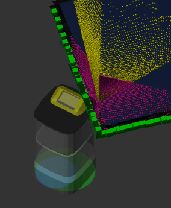
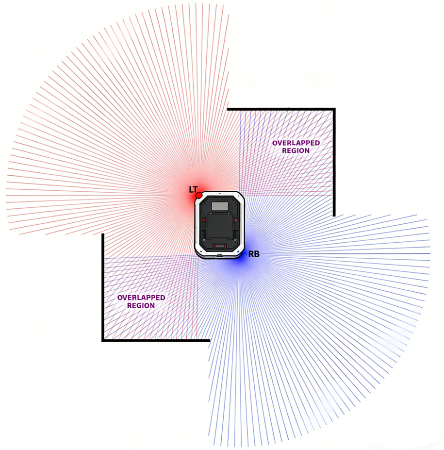

# Calibration

Calibrate the IMU, cameras, and lidars. Run each calibration with the robot on a level surface and the surrounding area clear.

## Recalibrate IMU {#recalibrate-imu}

Initiates IMU calibration. The robot must remain perfectly still on a hard, flat surface during this process.

```bash
curl -X POST \
  -H "Content-Type: application/json" \
  http://192.168.25.25:8090/services/imu/recalibrate
```

This service call only triggers the calibration; the actual process typically takes 10 to 20 seconds to complete.

Once the calibration is finished, a notification will be sent via the `/action` WebSocket topic.

**Sample Success Output:**

```json
{
  "topic": "/action",
  "timestamp": 1681733608.653,
  "email": "",
  "username": "",
  "deviceName": "718220110000909",
  "action": "recalibrate_imu",
  "message": "IMU calibration succeeded"
}
```

**Sample Failure Output:**

```json
{
  "topic": "/action",
  "timestamp": 1681733580.702,
  "email": "",
  "username": "",
  "deviceName": "718220110000909",
  "action": "recalibrate_imu",
  "message": "error: IMU calibration failed. Failed to rotate to right"
}
```

## Calibrate Gyroscope Scale {#calibrate-gyroscope-scale}

Initiates gyroscope scale calibration. The robot must remain perfectly still on a hard, flat surface during this process.

```bash
curl -X POST \
  -H "Content-Type: application/json" \
  http://192.168.25.25:8090/services/imu/calibrate_gyro_scale
```

This service call only triggers the calibration; the actual process typically takes about 20 seconds to complete.

Once the calibration is finished, a notification will be sent via the `/action` WebSocket topic.

**Sample Success Output:**

```json
{
  "topic": "/action",
  "timestamp": 1681733608.653,
  "email": "",
  "username": "",
  "deviceName": "718220110000909",
  "action": "calibrate_gyro_scale",
  "message": "Gyroscope scale calibration succeeded"
}
```

**Sample Failure Output:**

```json
{
  "topic": "/action",
  "timestamp": 1681733580.702,
  "email": "",
  "username": "",
  "deviceName": "718220110000909",
  "action": "calibrate_gyro_scale",
  "message": "error: Gyroscope scale calibration failed. Please remove nearby obstacles."
}
```

## Clear Gyro Scale {#clear-gyro-scale}

Proxies to the `/imu/clear_gyro_scale` ROS service (`std_srvs/Trigger`) provided by `imu_node`. Clears the IMU gyro scale calibration, marking the gyro as not calibrated.

### Route

```text
POST /ros/imu/clear_gyro_scale
```

### Request

No parameters, no request body. `Accept` is ignored — the response is always `application/json`.

### Response

`200` `application/json`:

```json
{ "success": true, "message": "Gyro scale cleared." }
```

### Additional error codes

<!-- prettier-ignore -->
| Status | Meaning                                                       |
| ------ | ------------------------------------------------------------- |
| `500`  | `imu_node` returned `success = false`; body is its `message`  |
| `502`  | ROS service call failed                                       |
| `504`  | ROS service was unavailable before timeout                    |

### Example

```bash
curl -X POST http://192.168.25.25:8090/ros/imu/clear_gyro_scale
```

### SDK usage

```ts
import { RobotApi } from "@kingsimba/axbot-sdk/robotApi";

const api = new RobotApi({ apiBase: "http://192.168.25.25:8090" });
await api.clearGyroScale();
```

---

## Calibrate Depth Cameras {#calibrate-depth-cameras}

This service aligns the point clouds from the depth cameras with the point cloud from the horizontal Lidar.

Before initiating calibration, ensure that:

- The robot is on a flat, level surface.
- The robot is facing a wall corner or a large, rectangular object.



```
POST /services/calibrate_depth_cameras
```

## Calibrate Depth Camera Masks {#calibrate-depth-camera-masks}

Some depth cameras may capture parts of the robot's own body. This service identifies which pixels should be masked to prevent the robot from mistaking itself for an obstacle.

Before calibrating, place the robot in an open area with no obstacles in the field of view of any depth cameras.

```bash
curl -X POST http://192.168.25.25:8090/services/calibrate_depth_camera_masks
```

## Calibrate Duo Lidar Poses {#calibrate-duo-lidar-poses}

This service is used to calibrate the poses of duo lidars mounted at the left-front and right-back corners.
This service should only be called when "caps.supportsDuoLidar" is true.

The service accepts an optional `calibration_step` parameter that selects the calibration mode:

```ts
interface CalibrateDuoLidarPosesRequest {
  calibration_step?: "single_shot" | "right_wall" | "front_wall";
}
```

### Single Shot Mode (Default) {#single-shot-mode}

Requires clear horizontal and vertical walls in one of the overlapping areas of the duo lidars' fields of view.



```bash
curl -X POST \
  -H "Content-Type: application/json" \
  http://192.168.25.25:8090/services/calibrate_duo_lidar_poses
```

### Right Wall Mode {#right-wall-mode}

Use this and **Front Wall Mode** when two perpendicular walls are hard to find. Only a single long wall is required.

**During calibration, ensure:**

- There should be a single long wall on the right side of the robot.
- The distance between the right side of the robot and the wall should be 1 – 2 meters.
- The wall must be long enough to be visible to both lidars.
- The wall and the right side of the robot should be precisely parallel — tolerance less than 0.5°.
- The ground should be flat.

```bash
curl -X POST \
  -H "Content-Type: application/json" \
  -d '{"calibration_step": "right_wall"}' \
  http://192.168.25.25:8090/services/calibrate_duo_lidar_poses
```

### Front Wall Mode {#front-wall-mode}

Run **Right Wall Mode** first, then rotate the robot to face the same wall.

**During calibration, ensure:**

- Finish right wall mode calibration first.
- The wall must be long enough to be visible to both lidars.
- The wall must be at least 2 meters away from the robot.
- The wall can be approximately parallel to the front edge of the robot — maximum tolerance of 5°.

```bash
curl -X POST \
  -H "Content-Type: application/json" \
  -d '{"calibration_step": "front_wall"}' \
  http://192.168.25.25:8090/services/calibrate_duo_lidar_poses
```

## Calibrate Mast Tick Base {#calibrate-mast-tick-base}

Proxies to the `/calibrate_mast_tick_base` ROS service (`std_srvs/Trigger`) provided by `jack_mast_node`. Triggers a mast tick-base calibration.

### Route

```text
POST /ros/jack_mast/calibrate_mast_tick_base
```

### Request

No parameters, no request body. `Accept` is ignored — the response is always `application/json`.

### Response

`200` `application/json`:

```json
{ "success": true, "message": "..." }
```

### Additional error codes

<!-- prettier-ignore -->
| Status | Meaning                                                       |
| ------ | ------------------------------------------------------------- |
| `500`  | `jack_mast_node` returned `success = false`; body is its `message` |
| `502`  | ROS service call failed                                       |
| `504`  | ROS service was unavailable before timeout                    |

### Example

```bash
curl -X POST http://192.168.25.25:8090/ros/jack_mast/calibrate_mast_tick_base
```
