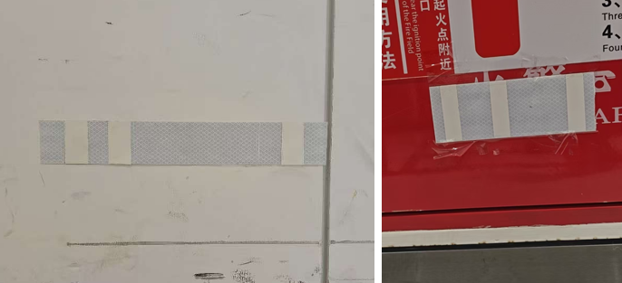

# Localization

Locate the robot on its map and query the pose of points of interest around it.

## Start Global Positioning {#start-global-positioning}

```bash
curl -X POST \
  -H "Content-Type: application/json"
  http://192.168.25.25:8090/services/start_global_positioning
```

**Parameters**

```ts
interface StartGlobalPositioningRequest {
  use_barcode?: boolean; // default to true.
  use_base_map_match?: boolean; // default to true.
}
```

Feedback can be monitored via the [Global Positioning State](./websocket-localization.md#global-positioning-state) WebSocket topic.

### Barcode {#barcode}



A barcode is a marker composed of interleaved reflective and non-reflective surfaces.
Each barcode at a site contains a unique ID, allowing the robot to determine its exact location unambiguously upon detection.

When `use_barcode` is set to `true`, it takes priority over point-cloud-based matching. Detected barcode matches are always considered highly reliable.
To utilize this feature, barcodes and their corresponding poses must be [collected and added to the map's overlays](./websocket-localization.md#collected-barcode).

## Query Pose {#query-pose}

This API retrieves the coordinates of various points of interest (POIs).

For example, when the robot docks on a charger, it calculates the charger’s pose
based on the robot’s position.

```bash
curl http://192.168.25.25:8090/services/query_pose/charger_pose
```

```json
{
  "pose": {
    "pos": [4.179, -26.094],
    "ori": 3.18
  }
}
```

Similarly, if a robot (e.g., a forklift or a trailer robot) is parked at a cargo location (e.g., a pallet or trailer), the system can infer the location's pose from the robot's current position.

```bash
curl http://192.168.25.25:8090/services/query_pose/pallet_pose
curl http://192.168.25.25:8090/services/query_pose/trailer_pose
```

```json
{
  "pose": {
    "pos": [4.179, -26.094],
    "ori": 3.18
  },

  // Since 2.13.0. If reference == 'center_of_front_edge', the returned pose is
  // the center of the pallet or trailer's front edge (new logic).
  // Otherwise, the pose is the center of the pallet or trailer (deprecated).
  "ref": "center_of_front_edge"
}
```

### Rack Pose {#rack-pose}

Calculates the pose of the jack plate's front or rear edge based on the robot's
current position. This is useful for defining rack POI coordinates on the map.

The `ref` query parameter specifies which edge to use:

- `center_of_front_edge` (default) — the center of the jack plate's **front** edge
- `center_of_rear_edge` — the center of the jack plate's **rear** edge

```bash
curl http://192.168.25.25:8090/services/query_pose/rack_pose?ref=center_of_front_edge
```

```json
{
  "pose": {
    "pos": [1.234, 5.678], // Calculated rack edge coordinates [x, y] in the world frame
    "ori": 1.571 // Yaw angle in the world frame (radians)
  },
  // Which edge was calculated: "center_of_front_edge" or "center_of_rear_edge"
  "ref": "center_of_front_edge"
}
```
