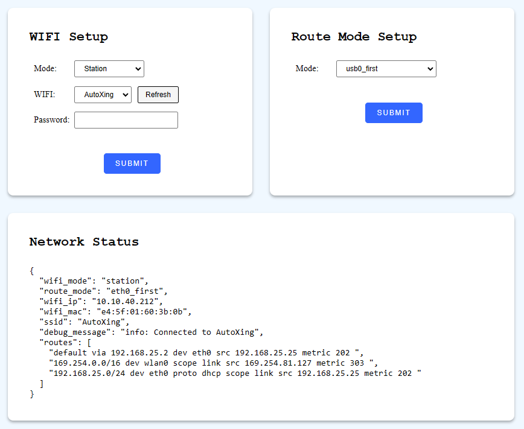

# Network

Configure Wi-Fi and routing on the robot's network interfaces.

## Configure Wi-Fi {#configure-wi-fi}

Switches the Wi-Fi between Access Point (AP) and Station mode.

```bash
curl -X POST \
  -H "Content-Type: application/json" \
  -d '{"mode": "station", "ssid":"xxxxxxxxx", "psk": "xxxxx"}' \
  http://192.168.25.25:8090/services/setup_wifi
```

**Parameters**

```ts
interface SetupWifiRequest {
  mode: "ap" | "station";
  ssid?: string; // SSID, required for station mode
  psk?: string; // Wi-Fi Protected Access Pre-Shared Key, required for station mode

  route_mode?: "eth0_first" | "wlan0_first" | "usb0_first" | "wlan0_usb0_auto_first";
}
```

## Set Route Mode {#set-route-mode}

Configures the routing table rules for the robot's chassis.

```bash
curl -X POST \
  -H "Content-Type: application/json" \
  -d '{"mode": "xxx"}' \
  http://192.168.25.25:8090/services/set_route_mode
```

**Parameters**

```ts
interface RouteModeRequest {
  mode: "eth0_first" | "wlan0_first" | "usb0_first" | "wlan0_usb0_auto_first";
}
```

`route_mode`: Determines the priority of network interfaces in the routing table:

- `eth0_first`: Sets `eth0` as the default route, if available.
- `wlan0_first`: Sets `wlan0` as the default route, if available.
- `usb0_first`: Sets `usb0` as the default route, if available.
- `wlan0_usb0_auto_first`: Based on `ping` results: if `wlan0` has internet connectivity, it is used as the default route; otherwise, `usb0` is used.

A static HTML page for network configuration is also available on the local network at: `http://192.168.25.25:8090/wifi_setup`


