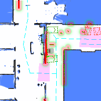

# Perception & Sensors

Power sensors on and off, capture a single frame, and probe external beacons.

## Power On or Off the Lidar {#power-on-or-off-the-lidar}

```bash
curl -X POST \
  -H "Content-Type: application/json" \
  -d '{"action": "power_on"}' \
  http://192.168.25.25:8090/services/baseboard/power_on_lidar
```

**Parameters**

```ts
class PowerOnRequest {
  action: "power_on" | "power_off";
}
```

## Power On or Off the Depth Camera {#power-on-or-off-the-depth-camera}

```bash
curl -X POST \
  -H "Content-Type: application/json" \
  -d '{"enable": true}' \
  http://192.168.25.25:8090/services/depth_camera/enable_cameras
```

**Parameters**

```ts
class EnableDepthCameraRequest {
  enable: boolean;
}
```

## Get RGB Image {#get-rgb-image}

Since 2.8.0, requires `caps.supportsGetRgbImage`.

Retrieves the latest image from an RGB camera. This is similar to the [WebSocket RGB Image Stream](./websocket-perception.md#rgb-image-stream) but is more efficient for use cases that only require occasional images.

```bash
curl -X POST \
  -H "Content-Type: application/json" \
  -d '{"topic": "/rgb_cameras/front/compressed"}' \
  http://192.168.25.25:8090/services/get_rgb_image
```

The response format is identical to the WebSocket topic.

## Get Nav. Thumbnail {#get-nav-thumbnail}

Since 2.8.0, requires `caps.supportsGetNavThumbnail`.

Retrieves an image snapshot of the robot and its surroundings, including the map, costmap, point cloud, and virtual walls.

The image is 200x200 pixels and can be used for error reporting.



```json
{
  "stamp": 1707211001,
  "map_name": "Ground Floor",
  "map_uid": "xxxxx",
  "map_version": 3,
  "overlays_version": 8,
  "map": {
    "resolution": 0.05,
    "size": [200, 200],
    "origin": [12.12345, -3.12345],
    "data": "iVBORw0KGgoAAAANS..." // base64 encoded PNG
  }
}
```

## Probe V2X Beacons {#probe-v2x-beacons}

This service sends messages to beacons to activate them for several seconds. This is useful for testing connectivity and triggering responses.

```bash
curl -X POST \
  -H "Content-Type: application/json" \
  http://192.168.25.25:8090/services/probe_v2x_beacons
```

Use the [V2X Health State](./websocket-environment.md#v2x-health-state) WebSocket topic to monitor beacon responses and health status.
