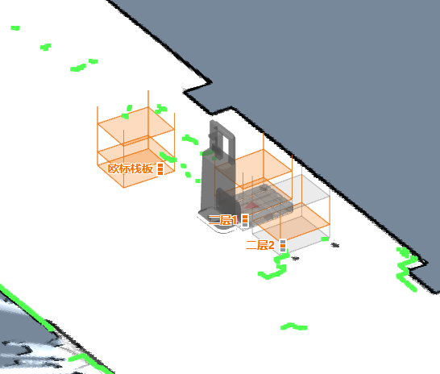
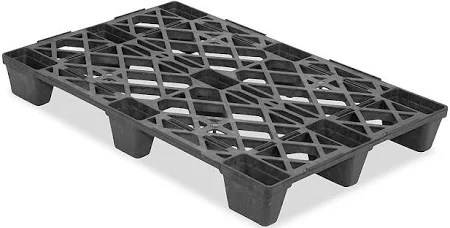
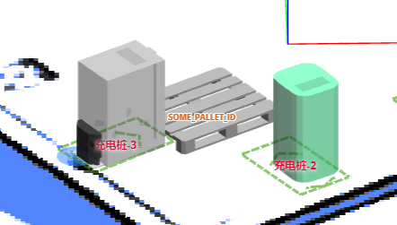
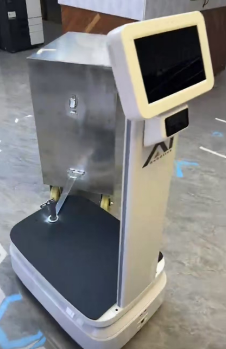

# Cargo & Equipment

State of the jack, roller, rack, pallet, and trailer handling equipment.

## Jack State {#jack-state}

The state of the jacking device.

```json
{
  "topic": "/jack_state",
  "state": "hold", // unknown, hold, jacking_up, jacking_down
  "progress": 0.35, // position of the jacking device, in percentage
  "self_checking": false,
  "self_check_state": "no_error" // no_error, up, down, error, unknown
}
```

## Roller State {#roller-state}

Since 2.9.0

The current state of the roller.

```json
{
  "topic": "/roller_state",
  "state": "hold" // unknown, hold, loading, unloading
}
```

## Detected Rack {#detected-rack}

```json
{
  "topic": "/detected_rack",
  "rack_detected": true,
  "frame": "map", // optional, valid when `rack_detected` is true
  // optional, valid when `rack_detected` is true
  "rack_box": {
    "pose": {
      "pos": [0.0, 0.0],
      "ori": 0.0
    },
    "width": 0.64324,
    "height": 0.69234
  },
  // optional, valid when `rack_detected` is true
  "rack_box_aligned": {
    "pose": {
      "pos": [0.0, 0.0],
      "ori": 0.0
    },
    "width": 0.66,
    "height": 0.7
  }
}
```

## Detected Rack States {#detected-rack-states}

Realtime observations of racks nearby, typically 1–2 Hz. This topic is NOT latched — each message contains only racks currently observed by the robot's sensors. Accumulated into `/map_rack_states` by the backend.

```json
{
  "topic": "/detected_rack_states",
  "map_uid": "a1b2c3d4",
  "racks": [
    {
      "poi_id": "rack_001",
      "levels": [
        {
          "timestamp_ns": 1712345678000000000,
          "level": 1,
          "state": "occupied"
        }
      ]
    }
  ]
}
```

- `map_uid` — ID of the map where racks are tracked.
- `racks` — Array of observed rack states.
- `poi_id` — Unique identifier for the rack point-of-interest.
- `levels` — Per-level occupancy for multi-level racks.
- `state` — One of `unknown`, `occupied`, or `free`.

## Map Rack States {#map-rack-states}

Accumulated full state of all known racks. Latched — caches the latest state so late subscribers receive the current data immediately, not just future updates. Racks not observed for approximately 30 minutes become `unknown` and are removed.



```json
{
  "topic": "/map_rack_states",
  "map_uid": "a1b2c3d4",
  "racks": [
    {
      "poi_id": "rack_001",
      "levels": [
        {
          "timestamp_ns": 1712345678000000000,
          "level": 1,
          "state": "occupied"
        },
        {
          "timestamp_ns": 1712345678000000000,
          "level": 2,
          "state": "free"
        }
      ]
    }
  ]
}
```

## Detected Pallets {#detected-pallets}

Since 2.10.0

Information about detected pallets.





```json
{
  "topic": "/detected_pallets",
  "pallets": [
    {
      "frame": "map",
      "pallet_id": "SOME_PALLET_ID",
      "pose": {
        "pos": [120.0, 50.0],
        "ori": 1.618
      },
      "size": {
        "width": 1.0,
        "depth": 1.3,
        "height": 0.3,
        "pocket_width": 0.3,
        "pocket_height": 0.2,
        "pocket_spacing": 0.2
      }
    }
  ]
}
```

## Detected Trailer {#detected-trailer}



```json
{
  "topic": "/detected_trailer",
  "detected": true,
  "hitch_position": [0, -0.35], // Relative to the robot's pose.
  "hitch_arm_length": 0.4, // The length of the hitch arm.
  "width": 0.5, // Width of the trailer.
  "depth": 1.0, // Depth (length) of the trailer.
  "pose": {
    // Pose of the trailer, relative to the robot.
    "pos": [0.31, -0.85],
    "ori": 0.13
  }
}
```
