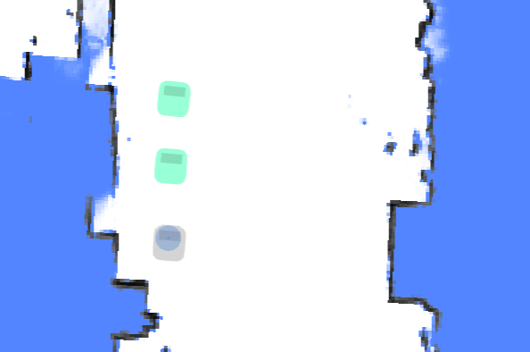
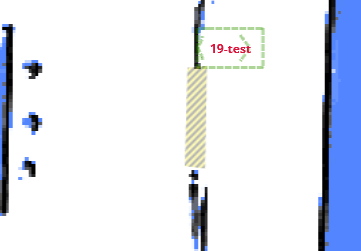

# Environment & Connectivity

Other moving parts of the site: nearby robots, automatic doors, V2X beacons, and GNSS/INS data.

## Nearby Robots {#nearby-robots}

With a dedicated hardware (optional installation), the robot can sense the whereabouts and the path of other robots.

This information can be used to avoid collision between robots or move in formation.



```json
{
  "topic": "/nearby_robots",
  "robots": [
    {
      "uid": "21922076002353N",
      "pose": { "pos": [1.05, 0.08], "ori": 1.69 },
      "trend": [],
      "footprint_digest": "0150acd9" // since 2.7.0, See /nearby_robot_footprints
    },
    {
      "uid": "21922076002413T",
      "pose": { "pos": [0.19, 0.01], "ori": 1.6 },
      "trend": [
        [0.19, 0.01],
        [0.12, -0.02]
      ],
      "footprint_digest": "7cb254d5"
    }
  ]
}
```

## Nearby Robot Footprints {#nearby-robot-footprints}

This topic contains detailed footprints of nearby robots.

In 2.7.0, the topic `/nearby_robots` adds a property `footprint_digest`.
It can be used with `/nearby_robot_footprints` to determine the footprint of nearby robots.

```json
{
  "topic": "/nearby_robot_footprints",
  "footprints": [
    {
      "digest": "0150acd9",
      "coordinates": [
        [0.0, -0.273],
        [0.14, -0.27],
        [0.2, -0.25],
        [0.24, -0.2],
        [0.25, -0.1],
        [0.25, 0.13],
        [0.24, 0.2],
        [0.18, 0.26],
        [0.15, 0.265],
        [0.14, 0.283],
        [-0.14, 0.283],
        [-0.15, 0.265],
        [-0.18, 0.26],
        [-0.24, 0.2],
        [-0.25, 0.13],
        [-0.25, -0.1],
        [-0.24, -0.2],
        [-0.2, -0.25],
        [-0.14, -0.27]
      ]
    }
  ]
}
```

## Nearby Auto Doors {#nearby-auto-doors}

This topic is used to visualize the state of auto-doors.



```json
{
  "topic": "/nearby_auto_doors",
  "doors": [
    {
      "name": "Abc",
      "mac": "123",
      "state": "closed",
      "polygon": [
        [2.937, 3.875],
        [2.899, 2.368],
        [3.208, 2.329],
        [3.237, 3.904]
      ]
    }
  ]
}
```

## V2X Health State {#v2x-health-state}

This topic provides the health status of V2X beacons, including message reception rates and active states.

```json
{
  "topic": "/v2x_health_state",
  "test_time_window": 10.0, // Time window in seconds for testing beacon health.
  "rate": 2, // Expected message rate per second.
  "beacon_ids": ["beacon_001", "beacon_002", "beacon_003"], // List of beacon identifiers.
  "beacon_message_counts": [18, 19, 3], // Number of messages received from each beacon during the test window.
  "beacon_active_states": [true, true, false] // Active state of each beacon (true if receiving messages at expected rate).
}
```

## CHC NavState (GNSS/INS) <a id="devpvt"></a> {#devpvt}

Since 2.14.0.

Raw navigation data from the CHC (华测) GNSS/INS sensor on topic `/devpvt`.

```json
{
  "topic": "/devpvt",
  "lat": 31.2301235, // Latitude in degrees, rounded to 7 decimals (about 1 cm).
  "lon": 121.4736543, // Longitude in degrees, rounded to 7 decimals.
  "speed": 0.352, // Ground speed (m/s).
  "heading": 270.123, // Track angle — velocity heading in vehicle frame, clockwise, [0, 360] deg.
  "heading2": 180.654, // Dual-antenna heading in vehicle frame, clockwise, [0, 360] deg.

  // Overall INS/GNSS fusion state (stat[0]):
  //   init | sat_nav | combined_nav | pure_inertial
  "combined_state": "combined_nav",

  // GNSS fix and heading quality (stat[1]):
  //   no_fix_no_heading | single_point | pseudorange_diff | combined_dead_reckoning
  //   rtk_fixed | rtk_float
  //   single_point_no_heading | pseudorange_diff_no_heading | rtk_fixed_no_heading | rtk_float_no_heading
  "gnss_state": "rtk_fixed",

  "warning": 0 // Sensor warning bitmask (0 = no warning).
}
```
