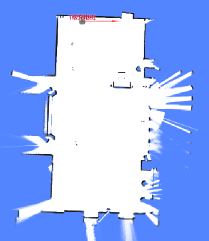
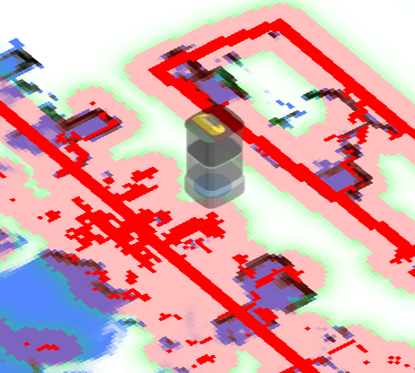
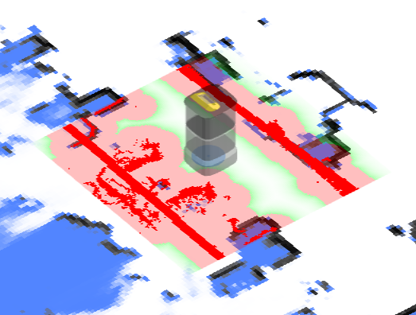
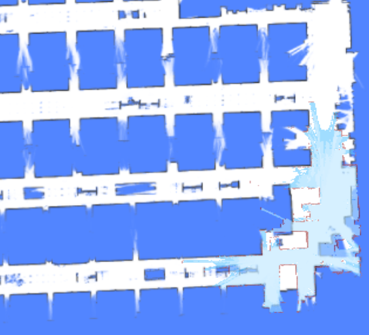
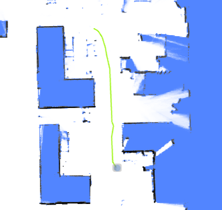
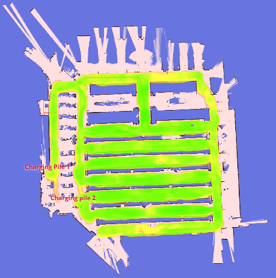
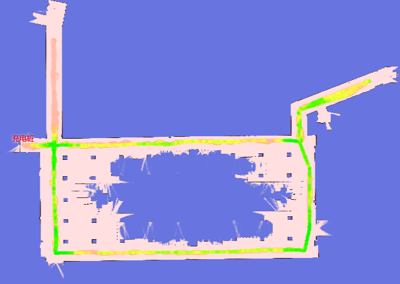

# Mapping

The map around the robot: current map images, costmaps, incremental updates, trajectories, and map-quality diagnostics.

## Map {#map}

In pure-localization mode, the `/map` topic contains the currently used map and is updated only once.

In mapping mode, the map is updated at regular, short intervals.



```json
{
  "topic": "/map",
  "resolution": 0.1, // The width/height of a single pixel, in meters.
  "size": [182, 59], // The size of the image, in pixels.
  "origin": [-8.1, -4.8], // The world coordinates of the lower-left pixel.
  "data": "iVBORw0KGgoAAAANSUhEUgAAALYAAAA7BAAAAA..." // Base64-encoded PNG file.
}
```

## Cached Topics {#cached-topics}

To handle very large maps, `/map_v2`, `/map/costmap_v2`, and `/incremental_map_v2` use `data_url` instead of `data`.

This significantly reduces the volume of data transmitted over the WebSocket. The images include `Cache-Control: public, max-age=` and `ETag` headers, allowing browsers and servers to cache them effectively.

```json
{
  "topic": "/map_v2",
  "stamp": 1693570028.939,
  "resolution": 0.05000000074505806,
  "size": [661, 1256],
  "origin": [-8.25, -36.05],
  "data_url": "static-files/map-d69c26ec2bdff8dad76fe6e8d3fa65d9b3041fc669ee3c0a96f7b544473fcec0.png"
}
```

Use `http:://192.168.25.25:8090/static-files/map-d69c26ec2bdff8dad76fe6e8d3fa65d9b3041fc669ee3c0a96f7b544473fcec0.png` to access the image later.

```
$ curl -I http://192.168.25.25:8090/static-files/map-d69c26ec2bdff8dad76fe6e8d3fa65d9b3041fc669ee3c0a96f7b544473fcec0.png
HTTP/1.1 200 OK
date: Fri, 01 Sep 2023 12:20:04 GMT
server: uvicorn
Content-Type: image/png
ETag: d69c26ec2bdff8dad76fe6e8d3fa65d9b3041fc669ee3c0a96f7b544473fcec0
Cache-Control: public, max-age=2592000
Vary: Accept, Cookie
Allow: GET, HEAD, OPTIONS
X-Page-Generation-Duration-ms: 18
X-Frame-Options: DENY
Content-Length: 141733
X-Content-Type-Options: nosniff
Referrer-Policy: same-origin
Cross-Origin-Opener-Policy: same-origin
```

## Obstacle Map {#obstacle-map}

This shows the obstacles detected around the robot, including data from all sensors and virtual walls.

This is intended for debugging purposes, providing a view through the robot's sensors.

Dark-red pixels represent the actual obstacles, while light-red pixels are extruded based on the robot's inscribed radius. The center of the robot should never enter the red area; doing so indicates a collision.

<!-- prettier-ignore -->
| Low Res. Costmap | High Res. Costmap |
| ---------------- | ----------------- |
| /maps/5cm/1hz    | /maps/1cm/1hz     |
| Used for path planning. | Used for collision detection. |
|  |  |

```
{
  "topic": "/maps/5cm/1hz", // or '/maps/1cm/1hz'
  "resolution": 0.05,
  "size": [
    200,
    200
  ],
  "origin": [
    -2.8,
    -6.2
  ],
  "data": "iVBORw0KGgoAAAANSUhEUgAAAMgAAADICA..." // Base64-encoded PNG file.
}
```

## Incremental Map {#incremental-map}

Incremental mapping enhances positioning in dynamic or frequently changing environments. This topic displays the newly updated map. It can be enabled in the `RobotAdmin` display panel.

While the image in the topic is grayscale, `RobotAdmin` transforms these colors: red pixels represent new obstacles, and light-blue pixels represent newly cleared space.



```json
{
  "topic": "/incremental_map",
  "stamp": 1693570082.777,
  "resolution": 0.05000000074505806,
  "size": [638, 881],
  "origin": [-21.95, -1.25],
  "data": "iVBORw0KGgoAAAANSUhEUgAAAn4AAANxBAAAAACaa..."
}
```

## Updated Map Slice {#updated-map-slice}

```json
{
  "topic": "/updated_map_slice",
  "width": 298,
  "height": 356,
  "resolution": 0.05,
  "origin_x": -4.4,
  "origin_y": -9.0,
  "data": "iVBORw0KGgoAAAANSUhEUg..." // Base64-encoded grayscale PNG.
}
```

## Trajectory {#trajectory}

The trail of the robot.

- In mapping mode, the trajectory represents the complete path of the entire mapping process.
- In pure-localization mode, the trajectory is periodically trimmed.



:::warning
For version 2.5.0 or below, this enable message is incorrectly named `/trajectory_node_list`.
To be safe, enable both `/trajectory` and `/trajectory_node_list`.
:::

```json
{
  "topic": "/trajectory",
  "points": [
    [2.0, 3.0],
    [2.1, 3.1],
    [2.4, 3.0],
    [2.7, 2.9],
    [3.0, 2.8],
    [3.6, 2.6],
    [3.7, 2.5],
    [3.9, 2.3],
    [4.1, 2.1],
    [3.9, -1.1],
    [3.8, -2.2]
  ]
}
```

## Environment Match Map {#environment-match-map}

This map reflects how well the point clouds match the existing map.

Red areas indicate changes in the environment. If significant changes are detected (indicated by excessive red), the map should be rebuilt.



Request:

```json
{ "enable_topic": "/env_match_map" }
```

Response:

```json
{
  "topic": "/env_match_map",
  "stamp": 1675326661.915,
  "resolution": 0.10000000149011612,
  "size": [579, 614],
  "origin": [-9.35, -34.75],
  "data": "iVBORw0KGgoAAAANSUhEUgAAAkMAA..."
}
```

## Environment Symmetry Map {#environment-symmetry-map}

This map reflects the degree of symmetry of the point cloud relative to the current environment.

Red indicates a featureless environment, such as a tunnel or a spacious lobby.



Request:

```json
{ "enable_topic": "/env_symmetry_map" }
```

Response:

```json
{
  "topic": "/env_symmetry_map",
  "stamp": 1674993781.916,
  "resolution": 0.10000000149011612,
  "size": [579, 614],
  "origin": [-9.35, -34.75],
  "data": "iVBORw0KGgoAAAANSUhEUgAAAkMAAAJmCAAAAAB..."
}
```
