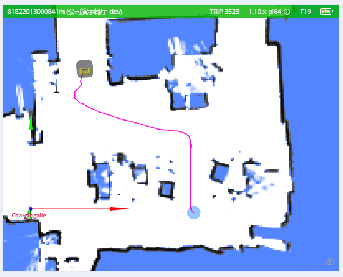

# Navigation & Planning

What the robot is doing and where it is going: planning state, paths, follow-target control, and robot geometry.

## Planning State {#planning-state}

Returns the execution state of the most recent move action.

```ts
enum ActionType {
  none,
  standard,
  charge,
  along_given_route, // Move along a specified track.
  return_to_elevator_waiting_point, // Used when failing to enter an elevator.
  enter_elevator,
  leave_elevator,
  pull_over, // (DO NOT USE) Pull over to make space for other robots.
  align_with_rack, // (DO NOT USE)
}

enum MoveState {
  none,
  idle,
  moving,
  succeeded,
  failed,
  cancelled,
}

enum StuckState {
  move_stucked,
  target_spin_stucked,
}

enum CargoAction {
  none,
  load, // The fork is already under the cargo, so `/load_cargo` can be called.
  unload, // The fork is already above the target rack, so `/unload_cargo` can be called.
}
```

```json
{
  "topic": "/planning_state",

  "map_uid": "xxxxxx", // The UID of the current map.

  // action
  "action_id": 3354,
  "action_type": "enter_elevator", // See ActionType (since 2.5.2).
  "move_state": "moving", // See MoveState.
  "fail_reason": 0, // Valid when move_state == failed.
  "fail_reason_str": "none", // Valid when move_state == failed.
  "remaining_distance": 2.8750057220458984, // In meters.

  // target related
  "target_poses": [
    {
      "pos": [4.08, 2.99],
      "ori": 0
    }
  ],

  // intent related
  "move_intent": "", // Deprecated by `action_type`.
  "intent_target_pose": {
    // The pose of the current target.
    "pos": [0, 0],
    "ori": 0
  },

  // stuck state
  "stuck_state": "move_stucked", // See StuckState (since 2.5.2).
  "in_elevator": true, // Optional (since 2.5.2).
  "viewport_blocked": true, // Optional (since 2.5.2).

  // Optional (since 2.9.0).
  // Destination is occupied by another robot, so it is waiting at the roadside.
  "is_waiting_for_dest": true,

  "docking_with_conveyer": true, // Optional (since 2.9.0).

  // Optional (since 2.11.0). Defaults to 0.
  // Only valid when moving along a specified route.
  // Indicates the number of points already passed.
  "given_route_passed_point_count": 3,

  // Optional. Defaults to "none".
  // The cargo action the robot is expecting next, so the business layer knows
  // whether to run `/load_cargo` or `/unload_cargo`. See CargoAction.
  "expected_cargo_action": "load"
}
```

## Global Path {#global-path}

The current global path.



```json
{
  "topic": "/path",
  "stamp": 1653301966860,
  "positions": [
    [0.94, 0.27, 0.01], // The heading (3rd member) was added in version 2.12.0.
    [0.94, 0.25, 0.01],
    [0.96, 0.25, 0.01]
  ]
}
```

## Local Path {#local-path}

This topic is used for debugging.

```json
{
  "topic": "/local_path",
  "width": 1.1,
  "color": "##FFEACD50", // RRGGBBAA
  "poses": [
    [1, 2, 3], // x, y, ori
    [3, 4, 3] // x, y, ori
  ]
}
```

## Follow Target State {#follow-target-state}

This topic is used for [following a moving target](./moves.md#follow-target).

The user should send this message to the robot at a consistent rate (approximately 2–4 Hz).

```json
{
  "topic": "/follow_target_state",
  "follow_state": "follow_pose|pause|fail",
  "target_pose": {
    // valid when follow_state == follow_pose
    "pos": [1.1, 2.2], // optional. The pose can have only pos or ori
    "ori": 1.2 // optional. The pose can have only pos or ori
  }
}
```

`follow_state` has the following values:

- `follow_pose`: Move to the given `target_pose`
- `pause`: Hold the robot still
- `fail`: Mark the current action as failed. To start following again, start another action.

## Robot Model {#robot-model}

The footprint of a robot may change dynamically. For example, it will become larger when it loads a rack.
This topic is used to know the dynamic footprint of the robot.

```json
{
  "topic": "/robot_model",
  "footprint": [
    [0.13, -0.25],
    [0.203, -0.228],
    [0.235, -0.178],
    [0.245, -0.077],
    [0.248, 0.029],
    [0.243, 0.163],
    [0.235, 0.217],
    [0.207, 0.26],
    [0.17, 0.291],
    [0.122, 0.324],
    [-0.122, 0.324],
    [-0.17, 0.291],
    [-0.207, 0.26],
    [-0.235, 0.217],
    [-0.243, 0.163],
    [-0.248, 0.029],
    [-0.245, -0.077],
    [-0.235, -0.178],
    [-0.203, -0.228],
    [-0.13, -0.25]
  ],
  // since 2.12.4 The expanded_footprint adds more safe zone around the robot
  "expanded_footprint": [
    [-0.245, -0.077],
    [-0.235, -0.178],
    [-0.203, -0.228],
    [-0.13, -0.25]
    "..."
  ]
  "width": 0.496
}
```

## Traveled Distance {#traveled-distance}

::: warning
Experimental Feature
:::

```json
{
  "topic": "/platform_monitor/travelled_distance",
  "start_time": 1653303520, // Start time of the current move.
  "duration": 60, // Execution time of the current move.
  "distance": 27.89, // Distance traveled during the current move.
  "accumulated_distance": 5230.0 // Total distance traveled since system startup.
}
```

## Robot Signal {#robot-signal}

Since 2.8.0, requires `caps.supportsRobotSignal`.

Indicators that signal whether the robot is turning left, turning right, or braking.

```json
{
  "topic": "/robot_signal",
  "turn_left": true, // turning left
  "turn_right": false, // turning right
  "brake": false, // braking
  "reverse": false // backing up
}
```
