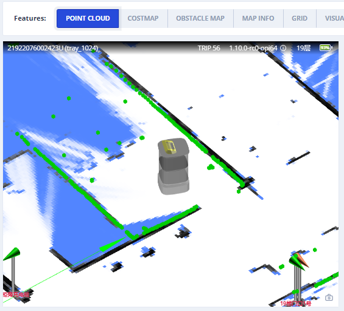
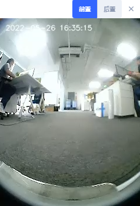
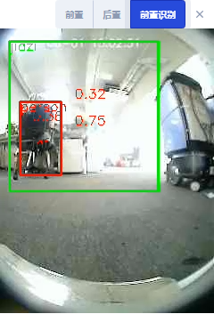
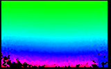

# Perception & Cameras

Sensor payloads: point clouds, detected objects, and camera streams.

## LiDAR Point Cloud {#lidar-point-cloud}



### Point Cloud Used for SLAM {#point-cloud-used-for-slam}

The combined point cloud from one or more LiDAR devices (if any) used for SLAM.
The coordinates are in the world frame.

```json
{
  "topic": "/scan_matched_points2",
  "stamp": 1653302201889,
  "points": [
    [7.83, 3.84, 0.04],
    [7.8, 3.88, 0.04],
    [7.79, 4.14, 0.04]
    ...
  ]
}
```

### Point Cloud for Individual LiDAR Devices {#point-cloud-for-individual-lidar-devices}

Since 2.12.0

This topic is used to debug individual LiDAR devices.
The coordinates are in the world frame.

Commonly used topic names include:

```
/horizontal_laser_2d/matched
/left_laser_2d/matched
/right_laser_2d/matched
/lt_laser_2d/matched (left top)
/rb_laser_2d/matched (right back)
```

```json
{
  "topic": "/horizontal_laser_2d/matched",
  "stamp": 1741764468.939,
  "fields": [
    {
      "name": "x",
      "data_type": "f32"
    },
    {
      "name": "y",
      "data_type": "f32"
    },
    {
      "name": "z",
      "data_type": "f32"
    },
    {
      "name": "intensity",
      "data_type": "f32"
    }
  ],
  "data": "QphAQHPLmkHDpvk/xcTEPk+RQED22ppBp6..." // Base64-encoded binary data.
}
```

## Vision Detected Objects {#vision-detected-objects}

::: warning
Experimental Feature
:::

```ts
enum VisualObjectLabel {
  none = 0,
  person = 1, // Person
  platformHandTruck = 2, // Platform hand truck
  scaffold = 3, // Scaffold
  queueStand = 4, // Queue stand
  portableGrandstand = 5, // Portable grandstand
}
```

```json
{
  "topic": "/vision_detected_objects",
  "boxes": [
    {
      "pose": { "pos": [0.32, 0.97], "ori": 0.0 }, // Object position and orientation.
      "dimensions": [0.0, 0.0, 0.0], // Object width, length, and height.
      "value": 0.8005573153495789,
      "label": 1 // VisualObjectLabel
    },
    {
      "pose": { "pos": [0.63, 1.08], "ori": 0.0 },
      "dimensions": [0.0, 0.0, 0.0],
      "value": 0.5348057150840759,
      "label": 1
    },
    {
      "pose": { "pos": [0.51, 0.74], "ori": 0.0 },
      "dimensions": [0.0, 0.0, 0.0],
      "value": 0.41888049244880676,
      "label": 1
    }
  ]
}
```

## RGB Video Stream {#rgb-video-stream}

H.264-encoded data stream.

```json
{
  "topic": "/rgb_cameras/front/video",
  "stamp": 1653303702.821,
  "data": "AAAAAWHCYADAAb5Bv4yqqseHIsjRwL5E4C4uX/CmRcXVaxddV3zf5uZO..."
}
```



::: tip
For browsers or Node.js, the stream can be decoded using [jmuxer](https://github.com/samirkumardas/jmuxer).
Use `flushingTime: 0` to minimize delay.

```js
this.jmuxer = new JMuxer({
  node: myNativeElement,
  mode: "video",
  flushingTime: 0,
});
```

:::

Current topics (may vary by device):

- `/rgb_cameras/front/video`
- `/rgb_cameras/back/video`
- `/rgb_cameras/front_augmented/video`: Augmented video stream for debugging vision-based object detection.



## RGB Image Stream {#rgb-image-stream}

JPEG-encoded image stream.

::: tip
Image stream is considerably larger than H264 video stream. For internet, please use video stream.
:::

```json
{
  "topic": "/rgb_cameras/front/compressed",
  "stamp": 1653303702.821,
  "format": "jpeg",
  "data": "YXNkZmFzZndlcndldHNhZGZhc2Rmd2V0cjJ5NDVqdHltNDU2..."
}
```

Currently topics: (Different devices may differ)

- `/rgb_cameras/front/compressed`
- `/rgb_cameras/back/compressed`

## Depth Camera Images {#depth-camera-images}

Since 2.12.0



```json
{
  "topic": "/depth_camera/downward/image",
  "size": [160, 100],
  "data": "iVBORw0KGgoAAAANSUhEUgAAALYAAAA7BAAAAA..." // Base64-encoded PNG file.
}
```

Commonly used topic names include:

```
/depth_camera/downward/image
/depth_camera/upward/image
/depth_camera/forward/image
```

## External RGB Camera Data {#external-rgb-camera-data}

If the robot is not equipped with built-in RGB cameras, external cameras can be installed to feed data back to the robot. This allows monitoring and vision-based functions to remain operational.

**Control Channel**

Upon receiving this topic, the peripheral device should:

1. Open the corresponding cameras
2. Set required resolution and FPS
3. Send data back through the data channel

```json
{
  "topic": "/external_rgb_camera_control",
  "enabled_devices": [
    {
      "name": "Front Camera",
      "width": 320,
      "height": 240,
      "fps": 5,
      "external_data_topic": "/external_rgb_data/front"
    }
  ]
}
```

**Data Channel**

Use this channel to send RGB data to the robot.

```json
{
  "topic": "/external_rgb_data/front", // The topic, specified in the control channel's `external_data_topic`
  "format": "jpeg", // must be jpeg
  "stamp": 1655896161.012, // The timestamp of the image
  "data": "Aasdfwe3424..." // base64 encoded JPEG data
}
```
