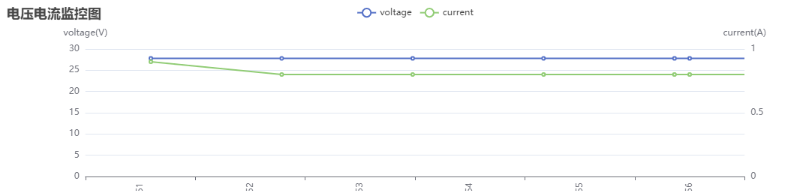
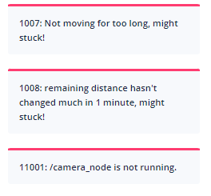
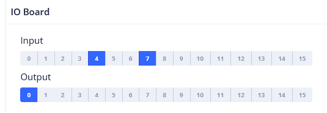

# System & Power

Device health and housekeeping: battery, sensor power state, alerts, application events, and I/O pins.

## Battery State {#battery-state}



```json
{
  "topic": "/battery_state",
  "secs": 1653299708, // Timestamp.
  "voltage": 26.3, // Battery voltage.
  "current": 3.6, // Battery current. Generally negative when charging and positive when running.
  "percentage": 0.64, // Battery percentage.
  "power_supply_status": "discharging" // charging/discharging/full.
}
```

## Detailed Battery State {#detailed-battery-state}

Since 2.11.0


```json
{
  "topic": "/detailed_battery_state",
  "secs": 1653299708, // Timestamp.
  "voltage": 26.3, // Battery voltage.
  "current": 3.6, // Battery current. Generally negative when charging and positive when running.
  "percentage": 0.64, // Battery percentage.
  "power_supply_status": "discharging", // charging/discharging/full.
  "cell_voltages": [4.141, 4.138, 4.139, 4.133, 4.136, 4.138, 4.138],
  "capacity": 14.0, // Ah
  "design_capacity": 15.0, // Ah
  "state_of_health": 0.93, // Percentage.
  "cycle_count": 80
}
```

## Sensor Manager State {#sensor-manager-state}

```ts
type PowerState =
  | "awake" // operational
  | "awakening" // Recovering from sleeping to awake. Usually lasts 2-3 seconds.
  | "sleeping"; // when sleeping, some sensors are turned off.
```

```json
{
  "topic": "/sensor_manager_state",
  "power_state": "awake" // see PowerState
}
```

## Alerts {#alerts}

This topic contains the currently active alerts.

The application should monitor alerts and take appropriate actions, such as:

1.  Returning to the charger when the battery is low (8501) or turning off the robot when the battery is critically low (8003).
2.  Warning users about docking errors (10001, 10002, 10003).
3.  Warning users about potential robot tip-overs (4008).
4.  Warning users about IMU calibration errors (4501, 4502) before creating a new map.
5.  Notifying us about application crashes (1001, 1002, 1003, 1004, 2001, 3001, 4001, 11001, etc.).
6.  Notifying us about sensor errors (4009, 5001, etc.).

A complete list of alerts is available at [this URL](https://rb-admin.autoxing.com/api/v1/static/error_code_map_full.json).



```json
{
  "topic": "/alerts",
  "alerts": [
    {
      "code": 6004,
      "level": "error",
      "msg": "Kernel temperature is higher than 80!"
    }
  ]
}
```

## App Events {#app-events}

Subscribe to `/app_events` to receive application events. This topic is not latched: events published before subscription are not replayed. Events use the reliable channel, but are not a persistent event log.

This topic uses the [protobuf frame format](./websocket.md#protobuf-messages), with wrapper type `APP_EVENT` (27) and payload `app_event` (field 37):

```proto
message AppEvent {
  string node_id = 1;
  uint64 stamp_ns = 2;
  string message = 3;
}
```

`node_id` identifies the event's node, `stamp_ns` is its timestamp in nanoseconds, and `message` contains the event text. Preserve `stamp_ns` as a 64-bit integer or decimal string to avoid precision loss.

## Device Info {#device-info}

Intended for clients that have already established a WebSocket connection but prefer not to make separate REST API requests.

Request:

```json
{ "topic": "/get_device_info_brief" }
```

Response:

```json
{
  "topic": "/device_info_brief",
  "rosversion": "1.15.11",
  "rosdistro": "noetic",
  "axbot_version": "master-pi64",
  "device": {
    "model": "waiter"
  },
  "baseboard": {
    "firmware_version": "22032218"
  },
  "wheel_control": {
    "device_type": "amps",
    "firmware_version": "amps_20211103"
  },
  "lidar": {
    "model": "ld06"
  },
  "bottom_sensor_pack": {
    "firmware_version": ""
  },
  "depth_camera": {
    "firmware_version": ""
  },
  "remote_params": {
    "tags": [
      "ihawk_crossfire",
      "RGB_external",
      "strongest_lidar_match",
      "mute_baseboard_com_output"
    ]
  }
}
```

## Digital Input/Output {#digital-input-output}

(Under discussion)

The IO board is a dedicated hardware component that connects to the robot via a USB port. It supports 16 or more IO pins operating at 12V or 24V. Certain IO pins are predefined for functions like brake lights or turn signals, while others are user-controllable.

The state of the IO pins:

```json
{
  "topic": "/io_pins_state",
  "inputs": [
    [0, 0, 1, 1, 1, 0, 0, 0],
    [0, 0, 1, 1, 0, 0, 0, 0]
  ],
  "outputs": [
    [0, 0, 1, 1, 1, 0, 0, 0],
    [0, 0, 1, 1, 0, 0, 0, 0]
  ]
}
```

Full update of output pins:

```json
{
  "topic": "/set_output_pins",
  "outputs": [
    [0, 0, 1, 1, 1, 1, 0, 0, 0],
    [0, 0, 1, 1, 1, 0, 0, 0, 0]
  ]
}
```

Selected update of output pins:

```json
{
  "topic": "/modify_output_pins",
  "enable": [0, 9, 13],
  "disable": [2, 4, 6]
}
```

## Raw Io-board State {#raw-io-board-state}



The current input and output states of the IO board.

```json
rtn = {
    "topic": "/raw_io_board_state",
    "inputs_active": [1, 0, 0, 1, 0, 0, 0, 0, 0, 0, 1, 1, 1, 1, 1, 0, 0, 1],
    "outputs_active": [1, 0, 0, 1, 0, 0, 0, 0, 0, 0, 1, 1, 1, 1, 1, 0, 0, 1],
}
```
