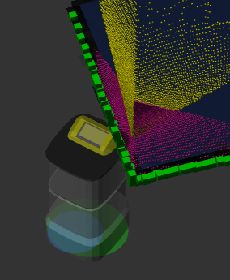
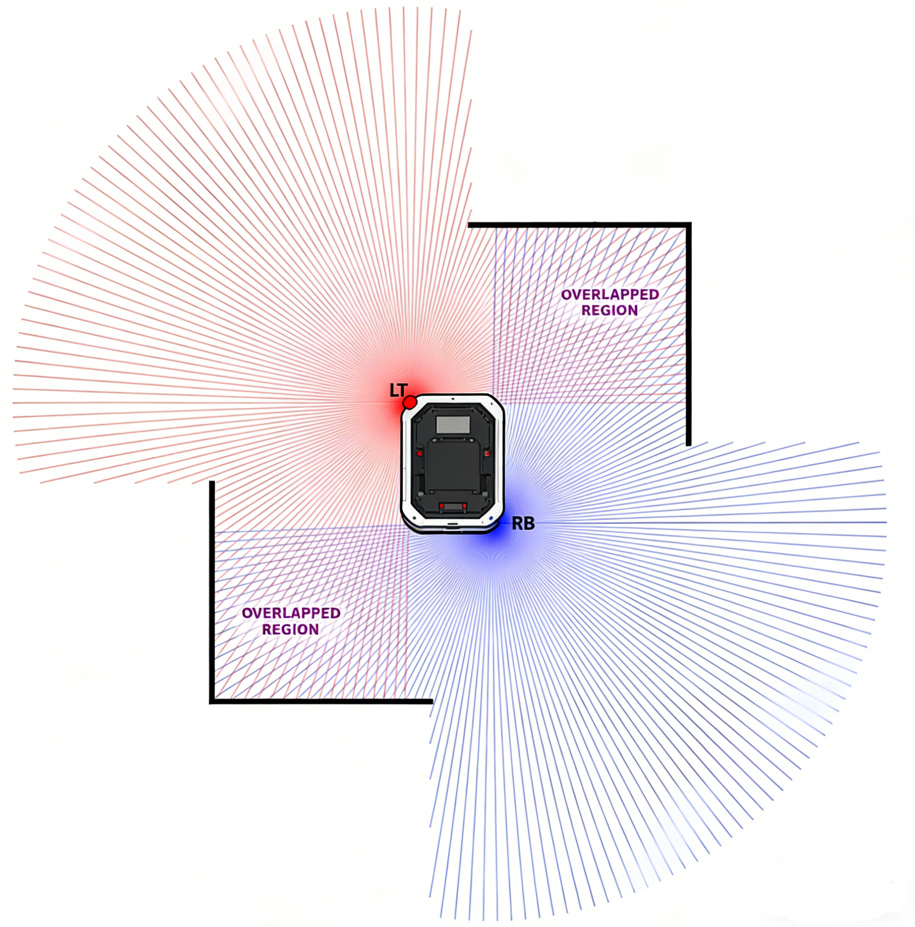

# 标定 (Calibration)

校准 IMU、摄像头和激光雷达。执行时请将机器人停放在水平地面上，并清空周围区域。

## 重新校准 IMU (Recalibrate IMU) {#recalibrate-imu}

启动 IMU 校准。在此过程中，机器人必须完全静止地停放在坚硬、平坦的地面上。

```bash
curl -X POST \
  -H "Content-Type: application/json" \
  http://192.168.25.25:8090/services/imu/recalibrate
```

此服务调用仅触发校准过程；实际过程通常需要 10 到 20 秒才能完成。

校准完成后，将通过 `/action` WebSocket Topic 发送通知。

**成功输出示例：**

```json
{
  "topic": "/action",
  "timestamp": 1681733608.653,
  "email": "",
  "username": "",
  "deviceName": "718220110000909",
  "action": "recalibrate_imu",
  "message": "IMU calibration succeeded"
}
```

**失败输出示例：**

```json
{
  "topic": "/action",
  "timestamp": 1681733580.702,
  "email": "",
  "username": "",
  "deviceName": "718220110000909",
  "action": "recalibrate_imu",
  "message": "error: IMU calibration failed. Failed to rotate to right"
}
```

## 校准陀螺仪刻度 (Calibrate Gyroscope Scale) {#calibrate-gyroscope-scale}

启动陀螺仪刻度校准。在此过程中，机器人必须完全静止地停放在坚硬、平坦的地面上。

```bash
curl -X POST \
  -H "Content-Type: application/json" \
  http://192.168.25.25:8090/services/imu/calibrate_gyro_scale
```

此服务调用仅触发校准过程；实际过程通常需要约 20 秒才能完成。

校准完成后，将通过 `/action` WebSocket Topic 发送通知。

**成功输出示例：**

```json
{
  "topic": "/action",
  "timestamp": 1681733608.653,
  "email": "",
  "username": "",
  "deviceName": "718220110000909",
  "action": "calibrate_gyro_scale",
  "message": "Gyroscope scale calibration succeeded"
}
```

**失败输出示例：**

```json
{
  "topic": "/action",
  "timestamp": 1681733580.702,
  "email": "",
  "username": "",
  "deviceName": "718220110000909",
  "action": "calibrate_gyro_scale",
  "message": "error: Gyroscope scale calibration failed. Please remove nearby obstacles."
}
```

## Clear Gyro Scale (清除陀螺仪比例标定) {#clear-gyro-scale}

转发 `imu_node` 提供的 ROS 服务 `/imu/clear_gyro_scale`（`std_srvs/Trigger`）。清除 IMU 陀螺仪比例标定，将陀螺仪标记为未标定。

### 路由 (Route)

```text
POST /ros/imu/clear_gyro_scale
```

### 请求 (Request)

无参数，无请求体。`Accept` 请求头会被忽略 — 响应始终为 `application/json`。

### 响应 (Response)

`200` `application/json`:

```json
{ "success": true, "message": "Gyro scale cleared." }
```

### 附加错误码 (Additional error codes)

<!-- prettier-ignore -->
| 状态码 | 含义                                                      |
| ------ | --------------------------------------------------------- |
| `500`  | `imu_node` 返回 `success = false`；响应体为其 `message`   |
| `502`  | ROS 服务调用失败                                          |
| `504`  | ROS 服务超时不可用                                        |

### 示例 (Example)

```bash
curl -X POST http://192.168.25.25:8090/ros/imu/clear_gyro_scale
```

### SDK 用法 (SDK usage)

```ts
import { RobotApi } from "@kingsimba/axbot-sdk/robotApi";

const api = new RobotApi({ apiBase: "http://192.168.25.25:8090" });
await api.clearGyroScale();
```

---

## 校准深度摄像头 (Calibrate Depth Cameras) {#calibrate-depth-cameras}

此服务将深度摄像头的点云与水平激光雷达的点云对齐。

在开始校准之前，请确保：

- 机器人位于平整、水平的地面上。
- 机器人正对着墙角或一个大型的长方体物体。



```
POST /services/calibrate_depth_cameras
```

## 校准深度摄像头遮罩 (Calibrate Depth Camera Masks) {#calibrate-depth-camera-masks}

某些深度摄像头可能会捕捉到机器人自身车体的一部分。此服务用于识别哪些像素应该被遮罩，以防止机器人误将自身视为障碍物。

在校准之前，请将机器人放置在一个开阔区域，且任何深度摄像头的视野内均无障碍物。

```bash
curl -X POST http://192.168.25.25:8090/services/calibrate_depth_camera_masks
```

## 校准双激光雷达位姿 (Calibrate Duo Lidar Poses) {#calibrate-duo-lidar-poses}

此服务用于校准安装在左前角和右后角的双激光雷达位姿。
仅当 "caps.supportsDuoLidar" 为 true 时才应调用此服务。

该服务接受一个可选的 `calibration_step` 参数，用于选择校准模式：

```ts
interface CalibrateDuoLidarPosesRequest {
  calibration_step?: "single_shot" | "right_wall" | "front_wall";
}
```

### 单次模式（默认）(Single Shot Mode) {#single-shot-mode}

在双激光雷达视野的重叠区域之一，必须有清晰的水平和垂直墙壁。



```bash
curl -X POST \
  -H "Content-Type: application/json" \
  http://192.168.25.25:8090/services/calibrate_duo_lidar_poses
```

### 右墙模式 (Right Wall Mode) {#right-wall-mode}

当难以找到两面垂直墙壁时，可使用此模式和**前墙模式**。只需要一面长墙。

**校准期间，请确保：**

- 机器人右侧应有一面长墙。
- 机器人右侧与墙壁之间的距离应为 1 – 2 米。
- 墙壁必须足够长，以便两个激光雷达都能看到。
- 墙壁与机器人右侧应精确平行——公差小于 0.5°。
- 地面应平坦。

```bash
curl -X POST \
  -H "Content-Type: application/json" \
  -d '{"calibration_step": "right_wall"}' \
  http://192.168.25.25:8090/services/calibrate_duo_lidar_poses
```

### 前墙模式 (Front Wall Mode) {#front-wall-mode}

先运行**右墙模式**，然后将机器人旋转面向同一面墙。

**校准期间，请确保：**

- 首先完成右墙模式校准。
- 墙壁必须足够长，以便两个激光雷达都能看到。
- 墙壁必须距离机器人至少 2 米。
- 墙壁可以大致与机器人前边缘平行——最大公差为 5°。

```bash
curl -X POST \
  -H "Content-Type: application/json" \
  -d '{"calibration_step": "front_wall"}' \
  http://192.168.25.25:8090/services/calibrate_duo_lidar_poses
```

## Calibrate Mast Tick Base (校准顶升桅杆刻度基准) {#calibrate-mast-tick-base}

转发 `jack_mast_node` 提供的 ROS 服务 `/calibrate_mast_tick_base`（`std_srvs/Trigger`）。触发顶升桅杆刻度基准校准。

### 路由 (Route)

```text
POST /ros/jack_mast/calibrate_mast_tick_base
```

### 请求 (Request)

无参数，无请求体。`Accept` 请求头会被忽略 — 响应始终为 `application/json`。

### 响应 (Response)

`200` `application/json`:

```json
{ "success": true, "message": "..." }
```

### 附加错误码 (Additional error codes)

<!-- prettier-ignore -->
| 状态码 | 含义                                                      |
| ------ | --------------------------------------------------------- |
| `500`  | `jack_mast_node` 返回 `success = false`；响应体为其 `message` |
| `502`  | ROS 服务调用失败                                          |
| `504`  | ROS 服务超时不可用                                        |

### 示例 (Example)

```bash
curl -X POST http://192.168.25.25:8090/ros/jack_mast/calibrate_mast_tick_base
```
