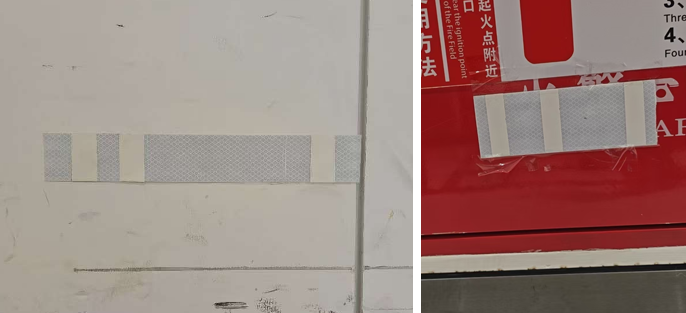

# 定位 (Localization)

在地图上定位机器人，并查询周边兴趣点的位姿。

## 启动全局定位 (Start Global Positioning) {#start-global-positioning}

```bash
curl -X POST \
  -H "Content-Type: application/json"
  http://192.168.25.25:8090/services/start_global_positioning
```

**参数**

```ts
interface StartGlobalPositioningRequest {
  use_barcode?: boolean; // 默认为 true。
  use_base_map_match?: boolean; // 默认为 true。
}
```

可以通过 [全局定位状态 (Global Positioning State)](./websocket-localization.md#global-positioning-state) WebSocket Topic 监控反馈。

### 条码 (Barcode) {#barcode}



条码是由反光和不反光表面交替组成的标记。
现场的每个条码都包含唯一的 ID，使机器人能够在检测到条码时明确地确定其精确位置。

当 `use_barcode` 设置为 `true` 时，它的优先级高于基于点云的匹配。检测到的条码匹配始终被视为高度可靠。
要利用此功能，必须[收集条码及其对应的位姿并将其添加到地图的 Overlays 中](./websocket-localization.md#collected-barcode)。

## 查询位姿 (Query Pose) {#query-pose}

此 API 用于检索各种兴趣点 (POI) 的坐标。

例如，当机器人对接充电桩时，它会根据机器人的位置计算充电桩的位姿。

```bash
curl http://192.168.25.25:8090/services/query_pose/charger_pose
```

```json
{
  "pose": {
    "pos": [4.179, -26.094],
    "ori": 3.18
  }
}
```

类似地，如果机器人（例如叉车或牵引机器人）停放在货物位置（例如托盘或挂车），系统可以从机器人当前位置推断出该位置的位姿。

```bash
curl http://192.168.25.25:8090/services/query_pose/pallet_pose
curl http://192.168.25.25:8090/services/query_pose/trailer_pose
```

```json
{
  "pose": {
    "pos": [4.179, -26.094],
    "ori": 3.18
  },

  // 自 2.13.0 起。如果 reference == 'center_of_front_edge'，返回的位姿是
  // 托盘或挂车前边缘的中心（新逻辑）。
  // 否则，位姿是托盘或挂车的中心（已弃用）。
  "ref": "center_of_front_edge"
}
```

### 货架位姿 (Rack Pose) {#rack-pose}

根据机器人当前位置计算顶升铁板前边缘或后边缘的位姿。这用于在地图上定义货架 POI 坐标。

通过 `ref` 查询参数指定对齐边缘：

- `center_of_front_edge`（默认）— 顶升铁板**前沿**中心
- `center_of_rear_edge` — 顶升铁板**后沿**中心

```bash
curl http://192.168.25.25:8090/services/query_pose/rack_pose?ref=center_of_front_edge
```

```json
{
  "pose": {
    "pos": [1.234, 5.678], // 货架边缘在世界坐标系下的 [x, y] 坐标
    "ori": 1.571 // 世界坐标系下的偏航角（弧度）
  },
  // 计算的是哪个边缘："center_of_front_edge" 或 "center_of_rear_edge"
  "ref": "center_of_front_edge"
}
```
