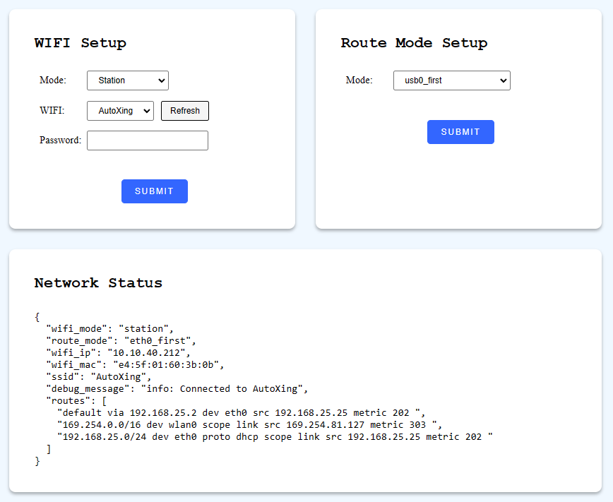

# 网络 (Network)

配置机器人的 Wi-Fi 与网络路由。

## 配置 Wi-Fi (Configure Wi-Fi) {#configure-wi-fi}

在热点 (AP) 模式和基站 (Station) 模式之间切换 Wi-Fi。

```bash
curl -X POST \
  -H "Content-Type: application/json" \
  -d '{"mode": "station", "ssid":"xxxxxxxxx", "psk": "xxxxx"}' \
  http://192.168.25.25:8090/services/setup_wifi
```

**参数**

```ts
interface SetupWifiRequest {
  mode: "ap" | "station";
  ssid?: string; // SSID，Station 模式下必填
  psk?: string; // Wi-Fi 预共享密钥，Station 模式下必填

  route_mode?: "eth0_first" | "wlan0_first" | "usb0_first" | "wlan0_usb0_auto_first";
}
```

## 设置路由模式 (Set Route Mode) {#set-route-mode}

配置机器人底盘的路由表规则。

```bash
curl -X POST \
  -H "Content-Type: application/json" \
  -d '{"mode": "xxx"}' \
  http://192.168.25.25:8090/services/set_route_mode
```

**参数**

```ts
interface RouteModeRequest {
  mode: "eth0_first" | "wlan0_first" | "usb0_first" | "wlan0_usb0_auto_first";
}
```

`route_mode`: 确定路由表中网络接口的优先级：

- `eth0_first`: 如果可用，将 `eth0` 设置为默认路由。
- `wlan0_first`: 如果可用，将 `wlan0` 设置为默认路由。
- `usb0_first`: 如果可用，将 `usb0` 设置为默认路由。
- `wlan0_usb0_auto_first`: 根据 `ping` 结果：如果 `wlan0` 具有互联网连接，则将其用作默认路由；否则，使用 `usb0`。

在此本地网络地址也可以访问静态的 Wi-Fi 配置 HTML 页面：`http://192.168.25.25:8090/wifi_setup`


