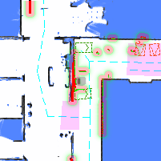

# 感知与传感器 (Perception & Sensors)

控制传感器电源、采集单帧图像，并探测外部信标。

## 开启或关闭激光雷达电源 (Power On or Off the Lidar) {#power-on-or-off-the-lidar}

```bash
curl -X POST \
  -H "Content-Type: application/json" \
  -d '{"action": "power_on"}' \
  http://192.168.25.25:8090/services/baseboard/power_on_lidar
```

**参数**

```ts
class PowerOnRequest {
  action: "power_on" | "power_off";
}
```

## 开启或关闭深度摄像头电源 (Power On or Off the Depth Camera) {#power-on-or-off-the-depth-camera}

```bash
curl -X POST \
  -H "Content-Type: application/json" \
  -d '{"enable": true}' \
  http://192.168.25.25:8090/services/depth_camera/enable_cameras
```

**参数**

```ts
class EnableDepthCameraRequest {
  enable: boolean;
}
```

## 获取 RGB 图像 (Get RGB Image) {#get-rgb-image}

自 2.8.0 起，需要 `caps.supportsGetRgbImage`。

检索 RGB 摄像头的最新图像。这类似于 [WebSocket RGB 图像流 (WebSocket RGB Image Stream)](./websocket-perception.md#rgb-image-stream)，但对于仅需偶尔获取图像的应用场景更高效。

```bash
curl -X POST \
  -H "Content-Type: application/json" \
  -d '{"topic": "/rgb_cameras/front/compressed"}' \
  http://192.168.25.25:8090/services/get_rgb_image
```

响应格式与 WebSocket Topic 相同。

## 获取导航缩略图 (Get Nav. Thumbnail) {#get-nav-thumbnail}

自 2.8.0 起，需要 `caps.supportsGetNavThumbnail`。

检索机器人及其周围环境的图像快照，包括地图、代价地图、点云和虚拟墙。

图像尺寸为 200x200 像素，可用于错误报告。



```json
{
  "stamp": 1707211001,
  "map_name": "Ground Floor",
  "map_uid": "xxxxx",
  "map_version": 3,
  "overlays_version": 8,
  "map": {
    "resolution": 0.05,
    "size": [200, 200],
    "origin": [12.12345, -3.12345],
    "data": "iVBORw0KGgoAAAANS..." // base64 编码的 PNG
  }
}
```

## 探测 V2X 信标 (Probe V2X Beacons) {#probe-v2x-beacons}

此服务向信标发送消息以激活它们数秒。这对于测试连接性并触发响应非常有用。

```bash
curl -X POST \
  -H "Content-Type: application/json" \
  http://192.168.25.25:8090/services/probe_v2x_beacons
```

使用 [V2X 健康状态 (V2X Health State)](./websocket-environment.md#v2x-health-state) WebSocket Topic 来监控信标响应和健康状态。
