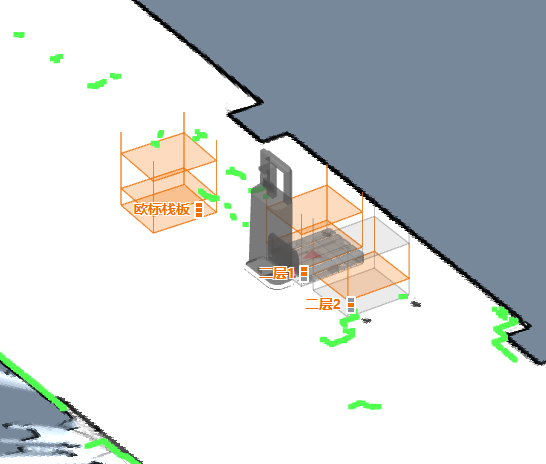
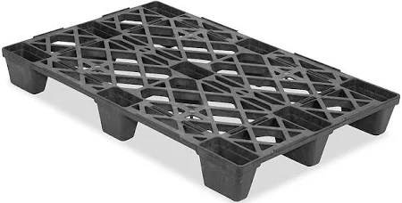
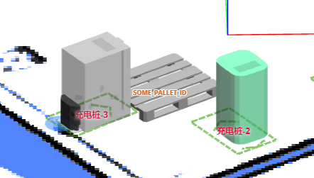
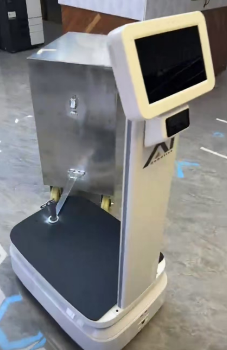

# 货物与设备 (Cargo & Equipment)

顶升、辊道、货架、托盘和挂车等装卸设备的状态。

## 顶升状态 (Jack State) {#jack-state}

顶升设备的状态。

```json
{
  "topic": "/jack_state",
  "state": "hold", // unknown, hold, jacking_up, jacking_down (未知, 保持, 正在上升, 正在下降)
  "progress": 0.35, // 顶升设备的位置，百分比表示
  "self_checking": false,
  "self_check_state": "no_error" // no_error, up, down, error, unknown (无错误, 上, 下, 错误, 未知)
}
```

## 辊道状态 (Roller State) {#roller-state}

自 2.9.0 起

辊道的当前状态。

```json
{
  "topic": "/roller_state",
  "state": "hold" // unknown, hold, loading, unloading (未知, 保持, 正在装货, 正在卸货)
}
```

## 检测到的货架 (Detected Rack) {#detected-rack}

```json
{
  "topic": "/detected_rack",
  "rack_detected": true,
  "frame": "map", // 可选，当 `rack_detected` 为 true 时有效
  // 可选，当 `rack_detected` 为 true 时有效
  "rack_box": {
    "pose": {
      "pos": [0.0, 0.0],
      "ori": 0.0
    },
    "width": 0.64324,
    "height": 0.69234
  },
  // 可选，当 `rack_detected` 为 true 时有效
  "rack_box_aligned": {
    "pose": {
      "pos": [0.0, 0.0],
      "ori": 0.0
    },
    "width": 0.66,
    "height": 0.7
  }
}
```

## 检测到的货架状态 (Detected Rack States) {#detected-rack-states}

机器人附近货架的实时观测结果，通常频率为 1–2 Hz。此 Topic **不进行缓存 (NOT latched)** ——每条消息仅包含机器人传感器当前观测到的货架。后端会将其累积到 `/map_rack_states` 中。

```json
{
  "topic": "/detected_rack_states",
  "map_uid": "a1b2c3d4",
  "racks": [
    {
      "poi_id": "rack_001",
      "levels": [
        {
          "timestamp_ns": 1712345678000000000,
          "level": 1,
          "state": "occupied"
        }
      ]
    }
  ]
}
```

- `map_uid` — 货架跟踪所在的地图 ID。
- `racks` — 观测到的货架状态数组。
- `poi_id` — 货架兴趣点的唯一标识符。
- `levels` — 多层货架各层的占用状态。
- `state` — 取值为 `unknown`、`occupied` 或 `free`。

## 货架地图状态 (Map Rack States) {#map-rack-states}

所有已知货架的累积完整状态。**已缓存 (Latched)** ——缓存最新状态，让后订阅的订阅者能立即获取当前数据，而不仅仅是未来的更新。约 30 分钟未观测到的货架将变为 `unknown` 并被移除。



```json
{
  "topic": "/map_rack_states",
  "map_uid": "a1b2c3d4",
  "racks": [
    {
      "poi_id": "rack_001",
      "levels": [
        {
          "timestamp_ns": 1712345678000000000,
          "level": 1,
          "state": "occupied"
        },
        {
          "timestamp_ns": 1712345678000000000,
          "level": 2,
          "state": "free"
        }
      ]
    }
  ]
}
```

## 检测到的托盘 (Detected Pallets) {#detected-pallets}

自 2.10.0 起

关于检测到的托盘的信息。





```json
{
  "topic": "/detected_pallets",
  "pallets": [
    {
      "frame": "map",
      "pallet_id": "SOME_PALLET_ID",
      "pose": {
        "pos": [120.0, 50.0],
        "ori": 1.618
      },
      "size": {
        "width": 1.0,
        "depth": 1.3,
        "height": 0.3,
        "pocket_width": 0.3,
        "pocket_height": 0.2,
        "pocket_spacing": 0.2
      }
    }
  ]
}
```

## 检测到的挂车 (Detected Trailer) {#detected-trailer}



```json
{
  "topic": "/detected_trailer",
  "detected": true,
  "hitch_position": [0, -0.35], // 相对于机器人位姿。
  "hitch_arm_length": 0.4, // 连接臂长度。
  "width": 0.5, // 挂车宽度。
  "depth": 1.0, // 挂车深度（长度）。
  "pose": {
    // 挂车的位姿，相对于机器人。
    "pos": [0.31, -0.85],
    "ori": 0.13
  }
}
```
