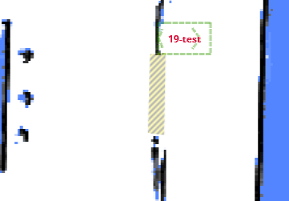

# 环境与连接 (Environment & Connectivity)

场地中的其他动态要素：附近机器人、自动门、V2X 信标以及 GNSS/INS 数据。

## 附近机器人 (Nearby Robots) {#nearby-robots}

配备专用硬件（可选安装）后，机器人可以感知其他机器人的位置和路径。

此信息可用于避免机器人之间的碰撞或进行编队移动。


```json
{
  "topic": "/nearby_robots",
  "robots": [
    {
      "uid": "21922076002353N",
      "pose": { "pos": [1.05, 0.08], "ori": 1.69 },
      "trend": [],
      "footprint_digest": "0150acd9" // 自 2.7.0 起，见 /nearby_robot_footprints
    },
    {
      "uid": "21922076002413T",
      "pose": { "pos": [0.19, 0.01], "ori": 1.6 },
      "trend": [
        [0.19, 0.01],
        [0.12, -0.02]
      ],
      "footprint_digest": "7cb254d5"
    }
  ]
}
```

## 附近机器人轮廓 (Nearby Robot Footprints) {#nearby-robot-footprints}

此 Topic 包含附近机器人的详细轮廓。

在 2.7.0 中，Topic `/nearby_robots` 增加了 `footprint_digest` 属性。
它可以与 `/nearby_robot_footprints` 结合使用，以确定附近机器人的轮廓。

```json
{
  "topic": "/nearby_robot_footprints",
  "footprints": [
    {
      "digest": "0150acd9",
      "coordinates": [
        [0.0, -0.273],
        [0.14, -0.27],
        [0.2, -0.25],
        [0.24, -0.2],
        [0.25, -0.1],
        [0.25, 0.13],
        [0.24, 0.2],
        [0.18, 0.26],
        [0.15, 0.265],
        [0.14, 0.283],
        [-0.14, 0.283],
        [-0.15, 0.265],
        [-0.18, 0.26],
        [-0.24, 0.2],
        [-0.25, 0.13],
        [-0.25, -0.1],
        [-0.24, -0.2],
        [-0.2, -0.25],
        [-0.14, -0.27]
      ]
    }
  ]
}
```

## 附近自动门 (Nearby Auto Doors) {#nearby-auto-doors}

此 Topic 用于可视化自动门的状态。



```json
{
  "topic": "/nearby_auto_doors",
  "doors": [
    {
      "name": "Abc",
      "mac": "123",
      "state": "closed",
      "polygon": [
        [2.937, 3.875],
        [2.899, 2.368],
        [3.208, 2.329],
        [3.237, 3.904]
      ]
    }
  ]
}
```

## V2X 健康状态 (V2X Health State) {#v2x-health-state}

此 Topic 提供 V2X 信标的健康状态，包括消息接收速率和激活状态。

```json
{
  "topic": "/v2x_health_state",
  "test_time_window": 10.0, // 测试信标健康的窗口时间，单位：秒。
  "rate": 2, // 期望的每秒消息速率。
  "beacon_ids": ["beacon_001", "beacon_002", "beacon_003"], // 信标标识符列表。
  "beacon_message_counts": [18, 19, 3], // 在测试窗口内收到每个信标的消息数量。
  "beacon_active_states": [true, true, false] // 每个信标的激活状态（如果按预期速率接收消息则为 true）。
}
```

## CHC 导航状态 (GNSS/INS) (CHC NavState (GNSS/INS)) {#devpvt}

自 `master`（尚未正式发布）起。

来自 `/devpvt` Topic 上的 CHC (华测) GNSS/INS 传感器的原始导航数据。

```json
{
  "topic": "/devpvt",
  "speed": 0.352, // 地面速度 (m/s)。
  "heading": 270.123, // 航迹角 — 车体坐标系下的速度航向，顺时针，[0, 360] 度。
  "heading2": 180.654, // 车体坐标系下的双天线航向，顺时针，[0, 360] 度。

  // 整体 INS/GNSS 融合状态 (stat[0]):
  //   init | sat_nav | combined_nav | pure_inertial
  "combined_state": "combined_nav",

  // GNSS 修复和航向质量 (stat[1]):
  //   no_fix_no_heading | single_point | pseudorange_diff | combined_dead_reckoning
  //   rtk_fixed | rtk_float
  //   single_point_no_heading | pseudorange_diff_no_heading | rtk_fixed_no_heading | rtk_float_no_heading
  "gnss_state": "rtk_fixed",

  "warning": 0 // 传感器警告掩码 (0 = 无警告)。
}
```
