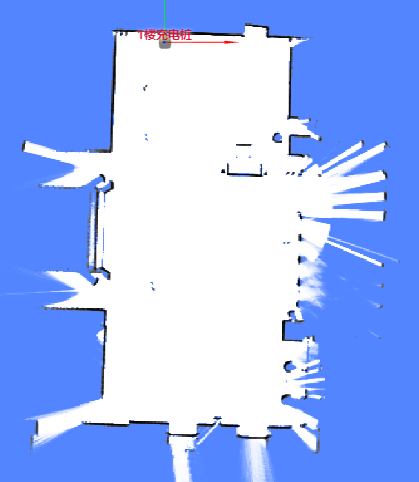
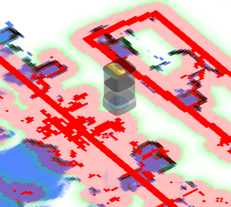
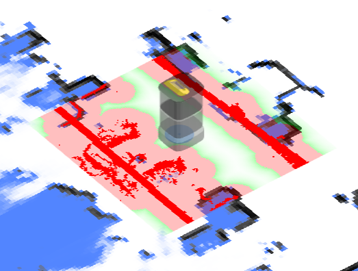
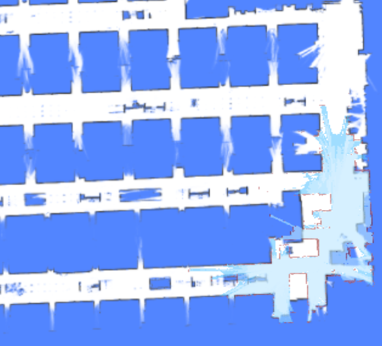
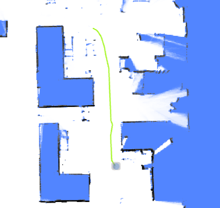
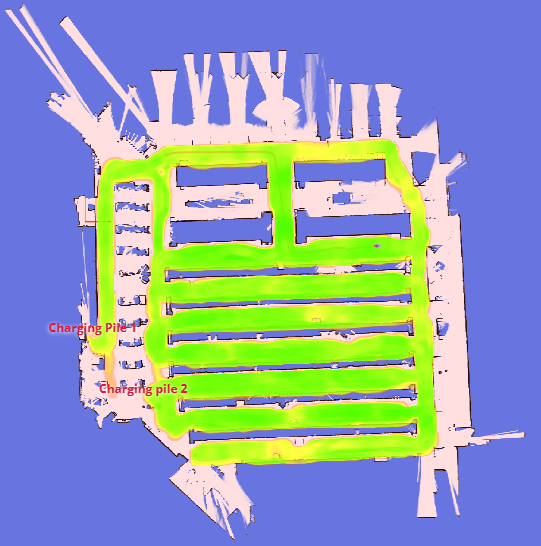
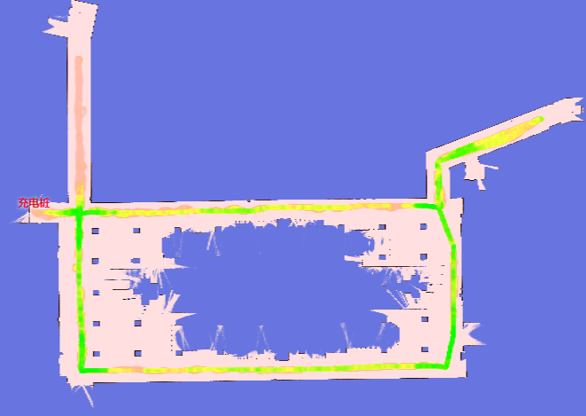

# 建图 (Mapping)

机器人周围的地图：当前地图图像、代价地图、增量更新、轨迹以及地图质量诊断。

## 地图 (Map) {#map}

在纯定位模式下，`/map` Topic 包含当前使用的地图，且仅更新一次。

在建图模式下，地图会以较短的固定间隔更新。



```json
{
  "topic": "/map",
  "resolution": 0.1, // 单个像素的宽/高，单位：米。
  "size": [182, 59], // 图像尺寸，单位：像素。
  "origin": [-8.1, -4.8], // 左下角像素的世界坐标。
  "data": "iVBORw0KGgoAAAANSUhEUgAAALYAAAA7BAAAAA..." // Base64 编码的 PNG 文件。
}
```

## 缓存 Topic (Cached Topics) {#cached-topics}

为了处理非常大的地图，`/map_v2`、`/map/costmap_v2` 和 `/incremental_map_v2` 使用 `data_url` 代替 `data`。

这显著减少了通过 WebSocket 传输的数据量。图像包含 `Cache-Control: public, max-age=` 和 `ETag` 响应头，允许浏览器和服务器进行有效的缓存。

```json
{
  "topic": "/map_v2",
  "stamp": 1693570028.939,
  "resolution": 0.05000000074505806,
  "size": [661, 1256],
  "origin": [-8.25, -36.05],
  "data_url": "static-files/map-d69c26ec2bdff8dad76fe6e8d3fa65d9b3041fc669ee3c0a96f7b544473fcec0.png"
}
```

随后可访问 `http:://192.168.25.25:8090/static-files/map-d69c26ec2bdff8dad76fe6e8d3fa65d9b3041fc669ee3c0a96f7b544473fcec0.png` 获取图像。

```
$ curl -I http://192.168.25.25:8090/static-files/map-d69c26ec2bdff8dad76fe6e8d3fa65d9b3041fc669ee3c0a96f7b544473fcec0.png
HTTP/1.1 200 OK
date: Fri, 01 Sep 2023 12:20:04 GMT
server: uvicorn
Content-Type: image/png
ETag: d69c26ec2bdff8dad76fe6e8d3fa65d9b3041fc669ee3c0a96f7b544473fcec0
Cache-Control: public, max-age=2592000
Vary: Accept, Cookie
Allow: GET, HEAD, OPTIONS
X-Page-Generation-Duration-ms: 18
X-Frame-Options: DENY
Content-Length: 141733
X-Content-Type-Options: nosniff
Referrer-Policy: same-origin
Cross-Origin-Opener-Policy: same-origin
```

## 障碍物地图 (Obstacle Map) {#obstacle-map}

显示机器人周围检测到的障碍物，包括来自所有传感器的数据和虚拟墙。

此功能主要用于调试，通过机器人的传感器视角提供观察。

深红色像素代表实际障碍物，而浅红色像素是根据机器人的内切圆半径扩充的。机器人的中心永远不应进入红色区域；否则表示发生了碰撞。

<!-- prettier-ignore -->
| 低分辨率代价地图 (Low Res. Costmap) | 高分辨率代价地图 (High Res. Costmap) |
| -------------------------- | ---------------------------- |
| /maps/5cm/1hz              | /maps/1cm/1hz                |
| 用于路径规划。               | 用于碰撞检测。                |
|  |   |

```
{
  "topic": "/maps/5cm/1hz", // 或 '/maps/1cm/1hz'
  "resolution": 0.05,
  "size": [
    200,
    200
  ],
  "origin": [
    -2.8,
    -6.2
  ],
  "data": "iVBORw0KGgoAAAANSUhEUgAAAMgAAADICA..." // Base64 编码的 PNG 文件。
}
```

## 增量地图 (Incremental Map) {#incremental-map}

增量建图可增强在动态或频繁变化环境中的定位。此 Topic 显示最新更新的地图。可以在 `RobotAdmin` 显示面板中启用它。

虽然 Topic 中的图像是灰度的，但 `RobotAdmin` 会转换这些颜色：红色像素代表新障碍物，浅蓝色像素代表新清理出的空间。



```json
{
  "topic": "/incremental_map",
  "stamp": 1693570082.777,
  "resolution": 0.05000000074505806,
  "size": [638, 881],
  "origin": [-21.95, -1.25],
  "data": "iVBORw0KGgoAAAANSUhEUgAAAn4AAANxBAAAAACaa..."
}
```

## 更新的地图切片 (Updated Map Slice) {#updated-map-slice}

```json
{
  "topic": "/updated_map_slice",
  "width": 298,
  "height": 356,
  "resolution": 0.05,
  "origin_x": -4.4,
  "origin_y": -9.0,
  "data": "iVBORw0KGgoAAAANSUhEUg..." // Base64 编码的灰度 PNG。
}
```

## 轨迹 (Trajectory) {#trajectory}

机器人的行驶轨迹。

- 在建图模式下，轨迹代表整个建图过程的完整路径。
- 在纯定位模式下，轨迹会定期被修剪。



:::warning
对于 2.5.0 或更低版本，此启用消息被错误地命名为 `/trajectory_node_list`。
为保险起见，请同时启用 `/trajectory` 和 `/trajectory_node_list`。
:::

```json
{
  "topic": "/trajectory",
  "points": [
    [2.0, 3.0],
    [2.1, 3.1],
    [2.4, 3.0],
    [2.7, 2.9],
    [3.0, 2.8],
    [3.6, 2.6],
    [3.7, 2.5],
    [3.9, 2.3],
    [4.1, 2.1],
    [3.9, -1.1],
    [3.8, -2.2]
  ]
}
```

## 环境匹配地图 (Environment Match Map) {#environment-match-map}

此地图反映了点云与现有地图的匹配程度。

红色区域表示环境发生了变化。如果检测到显著变化（红色区域过多），则应重建地图。



请求：

```json
{ "enable_topic": "/env_match_map" }
```

响应：

```json
{
  "topic": "/env_match_map",
  "stamp": 1675326661.915,
  "resolution": 0.10000000149011612,
  "size": [579, 614],
  "origin": [-9.35, -34.75],
  "data": "iVBORw0KGgoAAAANSUhEUgAAAkMAA..."
}
```

## 环境对称性地图 (Environment Symmetry Map) {#environment-symmetry-map}

此地图反映了点云相对于当前环境的对称程度。

红色表示特征缺失的环境，如隧道或宽敞的大厅。



请求：

```json
{ "enable_topic": "/env_symmetry_map" }
```

响应：

```json
{
  "topic": "/env_symmetry_map",
  "stamp": 1674993781.916,
  "resolution": 0.10000000149011612,
  "size": [579, 614],
  "origin": [-9.35, -34.75],
  "data": "iVBORw0KGgoAAAANSUhEUgAAAkMAAAJmCAAAAAB..."
}
```
