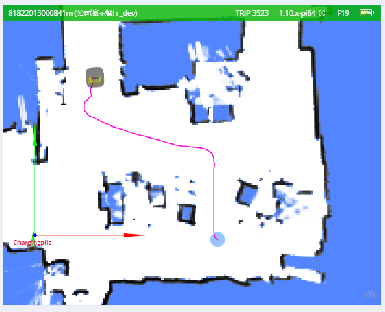

# 导航与规划 (Navigation & Planning)

机器人在做什么、要去哪里：规划状态、路径、跟随目标控制以及机器人几何。

## 规划状态 (Planning State) {#planning-state}

返回最近一次移动动作的执行状态。

```ts
enum ActionType {
  none,
  standard,
  charge, // 充电
  along_given_route, // 沿指定轨迹移动。
  return_to_elevator_waiting_point, // 用于进入电梯失败时。
  enter_elevator, // 进入电梯
  leave_elevator, // 离开电梯
  pull_over, // (不建议使用) 靠边停车以避让其他机器人。
  align_with_rack, // (不建议使用)
}

enum MoveState {
  none,
  idle, // 空闲
  moving, // 移动中
  succeeded, // 成功
  failed, // 失败
  cancelled, // 已取消
}

enum StuckState {
  move_stucked, // 移动受阻
  target_spin_stucked, // 目标旋转受阻
}

enum CargoAction {
  none,
  load, // 货叉已经到达货物下方，可以执行 `/load_cargo`。
  unload, // 货叉已经到达目标货架上方，可以执行 `/unload_cargo`。
}
```

```json
{
  "topic": "/planning_state",

  "map_uid": "xxxxxx", // 当前地图的 UID。

  // action (动作)
  "action_id": 3354,
  "action_type": "enter_elevator", // 见 ActionType (自 2.5.2 起)。
  "move_state": "moving", // 见 MoveState。
  "fail_reason": 0, // 当 move_state == failed 时有效。
  "fail_reason_str": "none", // 当 move_state == failed 时有效。
  "remaining_distance": 2.8750057220458984, // 单位：米。

  // 目标相关
  "target_poses": [
    {
      "pos": [4.08, 2.99],
      "ori": 0
    }
  ],

  // 意图相关
  "move_intent": "", // 已被 `action_type` 废弃。
  "intent_target_pose": {
    // 当前目标的位姿。
    "pos": [0, 0],
    "ori": 0
  },

  // 受阻状态
  "stuck_state": "move_stucked", // 见 StuckState (自 2.5.2 起)。
  "in_elevator": true, // 可选 (自 2.5.2 起)。
  "viewport_blocked": true, // 可选 (自 2.5.2 起)。

  // 可选 (自 2.9.0 起)。
  // 目的地被其他机器人占用，因此在路边等待。
  "is_waiting_for_dest": true,

  "docking_with_conveyer": true, // 可选 (自 2.9.0 起)。

  // 可选 (自 2.11.0 起)。默认为 0。
  // 仅在沿指定路线移动时有效。
  // 表示已经通过的点数量。
  "given_route_passed_point_count": 3,

  // 可选。默认为 "none"。
  // 机器人接下来期望执行的货物动作，业务端可据此决定执行 `/load_cargo` 还是 `/unload_cargo`。
  // 见 CargoAction。
  "expected_cargo_action": "load"
}
```

## 全局路径 (Global Path) {#global-path}

当前全局路径。



```json
{
  "topic": "/path",
  "stamp": 1653301966860,
  "positions": [
    [0.94, 0.27, 0.01], // 航向角（第 3 个成员）在 2.12.0 版本中添加。
    [0.94, 0.25, 0.01],
    [0.96, 0.25, 0.01]
  ]
}
```

## 局部路径 (Local Path) {#local-path}

此 Topic 用于调试。

```json
{
  "topic": "/local_path",
  "width": 1.1,
  "color": "##FFEACD50", // RRGGBBAA
  "poses": [
    [1, 2, 3], // x, y, 朝向
    [3, 4, 3] // x, y, 朝向
  ]
}
```

## 跟随目标状态 (Follow Target State) {#follow-target-state}

此 Topic 用于[跟随移动目标](./moves.md#follow-target)。

用户应以固定的速率（约 2–4 Hz）将此消息发送给机器人。

```json
{
  "topic": "/follow_target_state",
  "follow_state": "follow_pose|pause|fail",
  "target_pose": {
    // 当 follow_state == follow_pose 时有效
    "pos": [1.1, 2.2], // 可选。位姿可以仅包含位置 (pos) 或朝向 (ori)
    "ori": 1.2 // 可选。位姿可以仅包含位置 (pos) 或朝向 (ori)
  }
}
```

`follow_state` 有以下几种取值：

- `follow_pose`: 移动到指定的 `target_pose`
- `pause`: 保持机器人静止
- `fail`: 将当前动作标记为失败。若要重新开始跟随，请启动另一个动作。

## 机器人模型 (Robot Model) {#robot-model}

机器人的轮廓（footprint）可能会动态变化。例如，加载货架后轮廓会变大。
此 Topic 用于获取机器人的动态轮廓。

```json
{
  "topic": "/robot_model",
  "footprint": [
    [0.13, -0.25],
    [0.203, -0.228],
    [0.235, -0.178],
    [0.245, -0.077],
    [0.248, 0.029],
    [0.243, 0.163],
    [0.235, 0.217],
    [0.207, 0.26],
    [0.17, 0.291],
    [0.122, 0.324],
    [-0.122, 0.324],
    [-0.17, 0.291],
    [-0.207, 0.26],
    [-0.235, 0.217],
    [-0.243, 0.163],
    [-0.248, 0.029],
    [-0.245, -0.077],
    [-0.235, -0.178],
    [-0.203, -0.228],
    [-0.13, -0.25]
  ],
  // 自 2.12.4 起，expanded_footprint 在机器人周围增加了更多安全区域
  "expanded_footprint": [
    [-0.245, -0.077],
    [-0.235, -0.178],
    [-0.203, -0.228],
    [-0.13, -0.25]
    "..."
  ]
  "width": 0.496
}
```

## 行驶距离 (Traveled Distance) {#traveled-distance}

::: warning
实验性功能
:::

```json
{
  "topic": "/platform_monitor/travelled_distance",
  "start_time": 1653303520, // 当前移动的开始时间。
  "duration": 60, // 当前移动的执行时间。
  "distance": 27.89, // 当前移动过程中行驶的距离。
  "accumulated_distance": 5230.0 // 自系统启动以来的总行驶距离。
}
```

## 机器人信号 (Robot Signal) {#robot-signal}

自 2.8.0 起，需要 `caps.supportsRobotSignal`。

指示机器人是否正在左转、右转或制动的信号灯。

```json
{
  "topic": "/robot_signal",
  "turn_left": true, // 正在左转
  "turn_right": false, // 正在右转
  "brake": false, // 正在制动
  "reverse": false // 正在倒车
}
```
