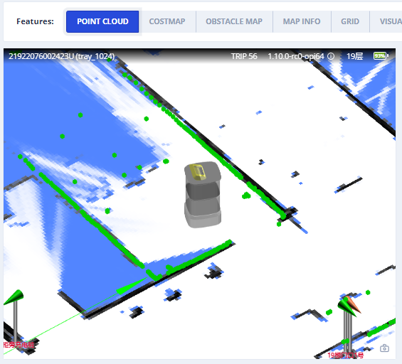
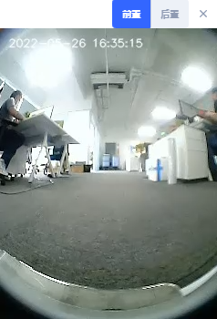
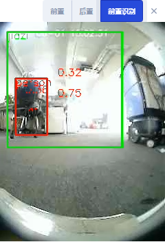
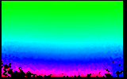

# 感知与摄像头 (Perception & Cameras)

传感器数据：点云、检测对象和摄像头视频流。

## 激光雷达点云 (LiDAR Point Cloud) {#lidar-point-cloud}



### 用于 SLAM 的点云 (Point Cloud Used for SLAM) {#point-cloud-used-for-slam}

来自一个或多个用于 SLAM 的激光雷达设备（如果有）的组合点云。
坐标位于世界坐标系中。

```json
{
  "topic": "/scan_matched_points2",
  "stamp": 1653302201889,
  "points": [
    [7.83, 3.84, 0.04],
    [7.8, 3.88, 0.04],
    [7.79, 4.14, 0.04]
    ...
  ]
}
```

### 单个激光雷达设备的点云 (Point Cloud for Individual LiDAR Devices) {#point-cloud-for-individual-lidar-devices}

自 2.12.0 起

此 Topic 用于调试单个激光雷达设备。
坐标位于世界坐标系中。

常用的 Topic 名称 include：

```
/horizontal_laser_2d/matched
/left_laser_2d/matched
/right_laser_2d/matched
/lt_laser_2d/matched (左前上)
/rb_laser_2d/matched (右后下)
```

```json
{
  "topic": "/horizontal_laser_2d/matched",
  "stamp": 1741764468.939,
  "fields": [
    {
      "name": "x",
      "data_type": "f32"
    },
    {
      "name": "y",
      "data_type": "f32"
    },
    {
      "name": "z",
      "data_type": "f32"
    },
    {
      "name": "intensity",
      "data_type": "f32"
    }
  ],
  "data": "QphAQHPLmkHDpvk/xcTEPk+RQED22ppBp6..." // Base64 编码的二进制数据。
}
```

## 视觉检测对象 (Vision Detected Objects) {#vision-detected-objects}

::: warning
实验性功能
:::

```ts
enum VisualObjectLabel {
  none = 0,
  person = 1, // 人
  platformHandTruck = 2, // 平台手推车
  scaffold = 3, // 脚手架
  queueStand = 4, // 排队隔离带
  portableGrandstand = 5, // 便携式看台
}
```

```json
{
  "topic": "/vision_detected_objects",
  "boxes": [
    {
      "pose": { "pos": [0.32, 0.97], "ori": 0.0 }, // 物体的位置和朝向。
      "dimensions": [0.0, 0.0, 0.0], // 物体的宽、长、高。
      "value": 0.8005573153495789,
      "label": 1 // VisualObjectLabel
    },
    {
      "pose": { "pos": [0.63, 1.08], "ori": 0.0 },
      "dimensions": [0.0, 0.0, 0.0],
      "value": 0.5348057150840759,
      "label": 1
    },
    {
      "pose": { "pos": [0.51, 0.74], "ori": 0.0 },
      "dimensions": [0.0, 0.0, 0.0],
      "value": 0.41888049244880676,
      "label": 1
    }
  ]
}
```

## RGB 视频流 (RGB Video Stream) {#rgb-video-stream}

H.264 编码的数据流。

```json
{
  "topic": "/rgb_cameras/front/video",
  "stamp": 1653303702.821,
  "data": "AAAAAWHCYADAAb5Bv4yqqseHIsjRwL5E4C4uX/CmRcXVaxddV3zf5uZO..."
}
```



::: tip
对于浏览器或 Node.js，可以使用 [jmuxer](https://github.com/samirkumardas/jmuxer) 解码该流。
使用 `flushingTime: 0` 以最小化延迟。

```js
this.jmuxer = new JMuxer({
  node: myNativeElement,
  mode: "video",
  flushingTime: 0,
});
```

:::

当前 Topic（可能因设备而异）：

- `/rgb_cameras/front/video`
- `/rgb_cameras/back/video`
- `/rgb_cameras/front_augmented/video`: 用于调试基于视觉的对象检测的增强视频流。



## RGB 图像流 (RGB Image Stream) {#rgb-image-stream}

JPEG 编码的图像流。

::: tip
图像流比 H264 视频流大得多。对于互联网传输，请使用视频流。
:::

```json
{
  "topic": "/rgb_cameras/front/compressed",
  "stamp": 1653303702.821,
  "format": "jpeg",
  "data": "YXNkZmFzZndlcndldHNhZGZhc2Rmd2V0cjJ5NDVqdHltNDU2..."
}
```

当前 Topic：（不同设备可能有所不同）

- `/rgb_cameras/front/compressed`
- `/rgb_cameras/back/compressed`

## 深度摄像头图像 (Depth Camera Images) {#depth-camera-images}

自 2.12.0 起



```json
{
  "topic": "/depth_camera/downward/image",
  "size": [160, 100],
  "data": "iVBORw0KGgoAAAANSUhEUgAAALYAAAA7BAAAAA..." // Base64 编码的 PNG 文件。
}
```

常用的 Topic 名称包括：

```
/depth_camera/downward/image
/depth_camera/upward/image
/depth_camera/forward/image
```

## 外部 RGB 摄像头数据 (External RGB Camera Data) {#external-rgb-camera-data}

如果机器人没有内置 RGB 摄像头，可以安装外部摄像头将数据回传给机器人。这使得监控和基于视觉的功能能够保持运行。

**控制通道**

收到此 Topic 后，周边设备应：

1. 打开相应的摄像头
2. 设置所需的分辨率和 FPS
3. 通过数据通道回传数据

```json
{
  "topic": "/external_rgb_camera_control",
  "enabled_devices": [
    {
      "name": "Front Camera",
      "width": 320,
      "height": 240,
      "fps": 5,
      "external_data_topic": "/external_rgb_data/front"
    }
  ]
}
```

**数据通道**

使用此通道向机器人发送 RGB 数据。

```json
{
  "topic": "/external_rgb_data/front", // 在控制通道的 `external_data_topic` 中指定的 Topic
  "format": "jpeg", // 必须为 jpeg
  "stamp": 1655896161.012, // 图像的时间戳
  "data": "Aasdfwe3424..." // base64 编码的 JPEG 数据
}
```
