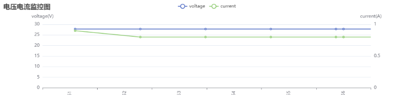
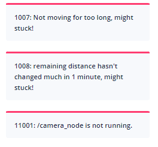
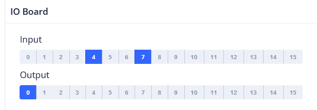

# 系统与电源 (System & Power)

设备健康与日常状态：电池、传感器电源状态、报警、应用事件和 IO 引脚。

## 电池状态 (Battery State) {#battery-state}



```json
{
  "topic": "/battery_state",
  "secs": 1653299708, // 时间戳。
  "voltage": 26.3, // 电池电压。
  "current": 3.6, // 电池电流。通常充电时为负，运行时为正。
  "percentage": 0.64, // 电池百分比。
  "power_supply_status": "discharging" // charging/discharging/full (充电/放电/充满)。
}
```

## 详细电池状态 (Detailed Battery State) {#detailed-battery-state}

自 2.11.0 起


```json
{
  "topic": "/detailed_battery_state",
  "secs": 1653299708, // 时间戳。
  "voltage": 26.3, // 电池电压。
  "current": 3.6, // 电池电流。通常充电时为负，运行时为正。
  "percentage": 0.64, // 电池百分比。
  "power_supply_status": "discharging", // charging/discharging/full。
  "cell_voltages": [4.141, 4.138, 4.139, 4.133, 4.136, 4.138, 4.138],
  "capacity": 14.0, // Ah
  "design_capacity": 15.0, // Ah
  "state_of_health": 0.93, // 百分比。
  "cycle_count": 80
}
```

## 传感器管理状态 (Sensor Manager State) {#sensor-manager-state}

```ts
type PowerState =
  | "awake" // 正常运行
  | "awakening" // 正在从睡眠恢复到唤醒。通常持续 2-3 秒。
  | "sleeping"; // 睡眠时，部分传感器会关闭。
```

```json
{
  "topic": "/sensor_manager_state",
  "power_state": "awake" // 见 PowerState
}
```

## 报警 (Alerts) {#alerts}

此 Topic 包含当前处于激活状态的报警。

应用程序应监控报警并采取适当措施，例如：

1.  当电量低时返回充电桩 (8501)，或在电量极低时关闭机器人 (8003)。
2.  向用户发出对接错误警告 (10001, 10002, 10003)。
3.  向用户发出潜在的机器人倾翻警告 (4008)。
4.  在创建新地图前，向用户发出 IMU 校准错误警告 (4501, 4502)。
5.  通知我们应用程序崩溃 (1001, 1002, 1003, 1004, 2001, 3001, 4001, 11001 等)。
6.  通知我们传感器错误 (4009, 5001 等)。

报警的完整列表可在[此 URL](https://rb-admin.autoxing.com/api/v1/static/error_code_map_full.json) 找到。



```json
{
  "topic": "/alerts",
  "alerts": [
    {
      "code": 6004,
      "level": "error",
      "msg": "Kernel temperature is higher than 80!"
    }
  ]
}
```

## 应用事件 (App Events) {#app-events}

订阅 `/app_events` 可接收应用事件。此 Topic 不缓存，订阅前发布的事件不会重播。事件使用可靠通道，但该通道不是持久化事件日志。

此 Topic 使用 [protobuf 帧格式](./websocket.md#protobuf-messages)，其 wrapper 类型为 `APP_EVENT` (27)，负载为 `app_event`（字段 37）：

```proto
message AppEvent {
  string node_id = 1;
  uint64 stamp_ns = 2;
  string message = 3;
}
```

`node_id` 标识事件所属节点，`stamp_ns` 是纳秒时间戳，`message` 是事件文本。请将 `stamp_ns` 保留为 64 位整数或十进制字符串，以避免精度损失。

## 设备信息 (Device Info) {#device-info}

适用于已经建立 WebSocket 连接但不希望进行单独 REST API 请求的客户端。

请求：

```json
{ "topic": "/get_device_info_brief" }
```

响应：

```json
{
  "topic": "/device_info_brief",
  "rosversion": "1.15.11",
  "rosdistro": "noetic",
  "axbot_version": "master-pi64",
  "device": {
    "model": "waiter"
  },
  "baseboard": {
    "firmware_version": "22032218"
  },
  "wheel_control": {
    "device_type": "amps",
    "firmware_version": "amps_20211103"
  },
  "lidar": {
    "model": "ld06"
  },
  "bottom_sensor_pack": {
    "firmware_version": ""
  },
  "depth_camera": {
    "firmware_version": ""
  },
  "remote_params": {
    "tags": [
      "ihawk_crossfire",
      "RGB_external",
      "strongest_lidar_match",
      "mute_baseboard_com_output"
    ]
  }
}
```

## 数字输入/输出 (Digital Input/Output) {#digital-input-output}

（讨论中）

IO 板是一个专用硬件组件，通过 USB 端口连接到机器人。它支持 16 个或更多工作在 12V 或 24V 的 IO 引脚。某些 IO 引脚预定义了功能（如刹车灯或转向信号灯），而其他引脚可以由用户控制。

IO 引脚的状态：

```json
{
  "topic": "/io_pins_state",
  "inputs": [
    [0, 0, 1, 1, 1, 0, 0, 0],
    [0, 0, 1, 1, 0, 0, 0, 0]
  ],
  "outputs": [
    [0, 0, 1, 1, 1, 0, 0, 0],
    [0, 0, 1, 1, 0, 0, 0, 0]
  ]
}
```

完整更新输出引脚：

```json
{
  "topic": "/set_output_pins",
  "outputs": [
    [0, 0, 1, 1, 1, 1, 0, 0, 0],
    [0, 0, 1, 1, 1, 0, 0, 0, 0]
  ]
}
```

选择性更新输出引脚：

```json
{
  "topic": "/modify_output_pins",
  "enable": [0, 9, 13],
  "disable": [2, 4, 6]
}
```

## 裸 IO 板状态 (Raw Io-board State) {#raw-io-board-state}



IO 板当前输入和输出的原始状态。

```json
rtn = {
    "topic": "/raw_io_board_state",
    "inputs_active": [1, 0, 0, 1, 0, 0, 0, 0, 0, 0, 1, 1, 1, 1, 1, 0, 0, 1],
    "outputs_active": [1, 0, 0, 1, 0, 0, 0, 0, 0, 0, 1, 1, 1, 1, 1, 0, 0, 1],
}
```
